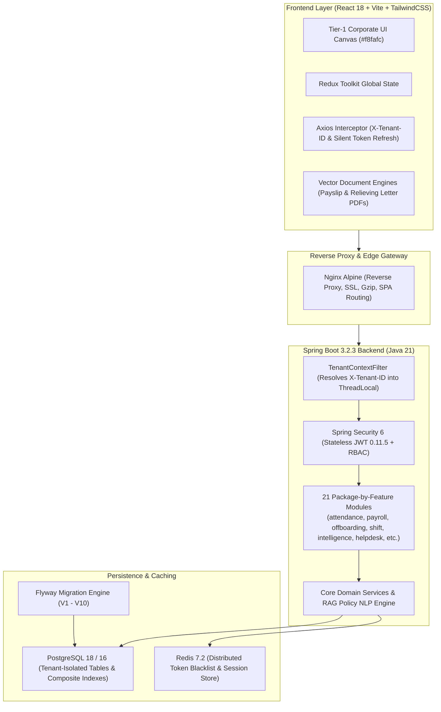

# 🏢 HRMS Enterprise Platform v2.0

> **Tier-1 Multi-Tenant Human Resource Management System & Workforce Intelligence Platform**  
> Built with **Spring Boot 3.2.3 (Java 21)**, **React 18 & Vite (TailwindCSS)**, **PostgreSQL 18 & 16**, **Flyway**, **Redis 7.2**, **JWT with Silent Token Rotation**, **Docker Multi-Stage**, and **GitHub Actions CI/CD**.

[](https://openjdk.org/)
[](https://spring.io/projects/spring-boot)
[](https://react.dev/)
[](https://www.postgresql.org/)
[](https://tailwindcss.com/)
[](https://www.docker.com/)
[](https://github.com/Naidusomineni/hrms-platform/actions)
[](#)

---

## 📋 Table of Contents

1. [Executive Overview & Architecture](#executive-overview)
2. [Master Engineering Standard (SKILLS.md)](#engineering-standard)
3. [Enterprise Module & Feature Matrix](#feature-matrix)
   - [Phase 1: SaaS Multi-Tenancy & Core RBAC](#phase-1)
   - [Phase 2: Core Operations, Attendance & Payroll](#phase-2)
   - [Phase 3: Talent, ATS & Organizational Governance](#phase-3)
   - [Phase 4: Enterprise Automation & Workforce Intelligence](#phase-4)
     - [Milestone 1: MNC Email Delivery & Credential Lifecycle](#m1-email)
     - [Milestone 2: Attendance 2.0 & Enterprise Payroll 2.0](#m2-attendance-payroll)
     - [Milestone 3: Full & Final Settlement (F&F) & Offboarding](#m3-offboarding)
     - [Milestone 4: Shift & Roster Management](#m4-shift-roster)
     - [Milestone 5: Generative HR Assistant & Workforce Intelligence](#m5-ai-intelligence)
   - [Phase 5: Production Cloud Hardening](#phase-5)
4. [Technology Stack](#tech-stack)
5. [Database Migrations (Flyway V1–V10)](#database-migrations)
6. [Quick Start & Local Setup](#quick-start)
7. [Production Docker Deployment](#docker-deployment)
8. [Automated QA Regression Test Suites (100% Pass)](#qa-test-suites)
9. [Default Credentials](#default-credentials)
10. [API Reference & Swagger](#api-reference)
11. [Repository Layout](#repository-layout)

---

## 🏛️ Executive Overview & Architecture <a name="executive-overview"></a>

The HRMS Enterprise Platform is architected as an **Enterprise Package-by-Feature Modular Monolith** designed for high throughput, strict multi-tenancy data isolation, and corporate compliance (Darwinbox, Rippling, Workday tier).



---

## 📐 Master Engineering Standard (SKILLS.md) <a name="engineering-standard"></a>

Every module adheres strictly to the architectural standards codified in [`SKILLS.md`](SKILLS.md) and [`.gemini/skills/hrms-enterprise-engineering/SKILL.md`](.gemini/skills/hrms-enterprise-engineering/SKILL.md):

1. **Zero Unbounded `findAll()` Hazard**:
   - Calling `repository.findAll()` without `tenant_id` breaks multi-tenant data boundaries and induces JVM Out-Of-Memory (`java.lang.OutOfMemoryError`).
   - Every database query strictly filters by `tenant_id` and enforces pagination via `Pageable`.
2. **Multi-Tenant Defense-in-Depth**:
   - All domain entities extend `BaseTenantEntity` which auto-binds `tenant_id` via `TenantContext.getTenantId()`.
   - `TenantContextFilter` cleans up `TenantContext.clear()` in a strict `finally` block to prevent thread pool contamination in Tomcat.
3. **Tier-1 Executive Design Standard**:
   - Strictly banned: Toy demo emojis (`🏢`, `🏠`, `☕`), neon glowing arcade gradients, broken character encodings (`—`), and unstyled Chrome cyan autofill shadows.
   - Adopted: Neutral `#f8fafc` canvas, crisp white cards with subtle borders (`border-slate-200`), vector Lucide icons, responsive tables, and accessible contrast.

---

## 🚀 Enterprise Module & Feature Matrix <a name="feature-matrix"></a>

### Phase 1: SaaS Multi-Tenancy & Core RBAC <a name="phase-1"></a>
- **Multi-Tenant Routing**: Seamless organization tenant resolution via `X-Tenant-ID` header, subdomains, and route tokens.
- **Tenant Isolation**: Separate tenant configurations, subscriptions, themes, logos, and custom department trees.
- **5-Tier Role Hierarchy**: `ROLE_SUPER_ADMIN` > `ROLE_ADMIN` > `ROLE_HR` > `ROLE_MANAGER` > `ROLE_EMPLOYEE`.
- **JWT Security 2.0**: 15-minute access token + 7-day refresh token rotation with distributed token blacklisting.
- **Account Lockout**: Automated 30-minute lockout after 5 consecutive failed login attempts.

### Phase 2: Core Operations, Attendance & Payroll <a name="phase-2"></a>
- **Employee Directory**: Enterprise staff directory with multi-field search, department filters, pagination, and soft delete.
- **Dynamic Attendance**: Check-in, check-out, working hours calculation, regularization workflows, and monthly attendance matrix.
- **Leave Management**: 9 statutory leave types, accrual balances, manager approval workflows, and calendar overlap protection.
- **Document Vault**: Encrypted employee document repository with categorization (Identity, Tax, Education, Certificates).

### Phase 3: Talent, ATS & Organizational Governance <a name="phase-3"></a>
- **Recruitment / ATS**: Job postings, candidate applicant tracking pipeline (Applied → Screening → Interview → Offer → Hired), and interview scorecards.
- **Performance & OKR**: Company objectives, key results, appraisal review cycles, self-ratings, and manager feedback.
- **Asset Management**: Enterprise hardware and IT asset inventory tracking, asset assignment history, and serial number indexing.

### Phase 4: Enterprise Automation & Workforce Intelligence <a name="phase-4"></a>

#### Milestone 1: MNC Email Delivery & Credential Security <a name="m1-email"></a>
- **Branded Welcome Emails**: Automated dispatch of official welcome emails containing Employee ID, portal URL, and auto-generated temporary credentials.
- **First-Login Password Enforcement**: `mustChangePassword` flag redirects first-time users to `/first-login-change-password` before granting application access.
- **6-Digit OTP Password Reset**: High-security OTP reset with BCrypt hashing in DB, 15-minute expiry, and 60-second resend countdown timer.
- **Dual-Mode Delivery**: Production SMTP with automatic development logger box fallback.

#### Milestone 2: Attendance 2.0 & Enterprise Payroll 2.0 <a name="m2-attendance-payroll"></a>
- **Live Shift Hub**: Real-time digital stopwatch (`04h 12m 30s`), 8h progress bar, and break management (`Take Break` / `Resume Work`).
- **Biometric Fleet**: Direct biometric turnstile REST webhook sync and bulk CSV punch file upload.
- **1-Click Vector PDF Payslips**: High-resolution vector PDF generator with embedded QR code verification, Indian rupee words converter, and digital corporate seal.
- **Bank NEFT/RTGS Batch Payouts**: 1-click batch payroll execution and standard banking disbursement CSV export.

#### Milestone 3: Full & Final Settlement (F&F) & Offboarding Lifecycle <a name="m3-offboarding"></a>
- **Separation Workflow**: Resignation submission, last working day (LWD) negotiation, and separation approval status tracking.
- **4-Department Clearance NOC**: Departmental asset recovery checkpoints (IT Assets, Finance, HR Admin, Reporting Manager).
- **Statutory Computation Engine**:
  - **Gratuity Formula**: `(15 * Basic Salary * Tenure Years) / 26` (tenure >= 5 years under Payment of Gratuity Act, 1972).
  - **Leave Encashment Formula**: `(Accumulated Leaves * Basic Salary) / 30`.
- **Official Documentation**: Automated vector PDF generation for **Relieving Letters**, **Experience Certificates**, and **F&F Statements**.

#### Milestone 4: Shift & Roster Management <a name="m4-shift-roster"></a>
- **Enterprise Shift Definitions**: Morning, Afternoon, General, Overnight Night shifts with grace periods and automated night differential allowances.
- **Weekly Team Roster Calendar**: Dynamic scheduling matrix by department and date range.
- **2-Tier Shift Swap State Machine**: Mutual peer consent (`PEER_ACCEPTED`) followed by manager approval, with dynamic atomic foreign key swap of schedules in PostgreSQL.

#### Milestone 5: Generative HR Assistant & Workforce Intelligence <a name="m5-ai-intelligence"></a>
- **AI HR Knowledge Copilot**: Natural language corporate policy RAG assistant answering employee questions regarding leave rollovers, medical cover, tax regimes, and shift rules with instant action shortcuts.
- **Workforce Attrition Radar**: Predictive flight risk analysis calculating multi-signal risk scores (Attendance Volatility, Compensation Stagnation, Tenure Cliff, Performance Disengagement) and manager retention interventions.
- **Smart ATS Candidate Match**: Evaluates candidate resumes against job posting requirements with skill gap radars, matched competencies, and hiring verdicts (`STRONG_HIRE`, `HIRE`, `CONSIDER`, `REJECT`).

#### IT Service Desk & Company Communication
- **Service Desk**: Internal IT and HR support ticketing with SLA deadline tracking, priority escalation, and diagnostic comment threads.
- **Announcements Feed**: Global and department-targeted broadcast notices with mandatory read-acknowledgement tracking.

### Phase 5: Production Cloud Hardening <a name="phase-5"></a>
- **Multi-Stage Dockerfiles**: Java 21 Temurin Alpine container with container-aware G1GC tuning (`-XX:MaxRAMPercentage=75.0`) and Node 20 / Nginx Alpine container with SPA fallback.
- **Production Docker Compose**: PostgreSQL 16 Alpine, Redis 7.2 Alpine, Spring Boot Backend, React Nginx Frontend, Prometheus, and Grafana.
- **GitHub Actions CI/CD**: Automated pipeline validating Java 21 compilation, unit tests, Vite bundle build, and Docker image packaging on every push.

---

## 🛠️ Technology Stack <a name="tech-stack"></a>

| Domain | Technology | Version | Description |
|:---|:---|:---|:---|
| **Backend Framework** | Spring Boot | 3.2.3 | Modular Monolith Enterprise Architecture |
| **Language** | Java | 21 (LTS) | Modern Java runtime with virtual thread capability |
| **Primary Database** | PostgreSQL | 18 / 16 | Relational store with composite multi-tenant indexes |
| **DB Migrations** | Flyway | 10.5.0 | Versioned, idempotent SQL migration pipeline |
| **Security & Auth** | Spring Security 6 / JJWT | 0.11.5 | Stateless JWT access + rotating refresh tokens |
| **Cache & Sessions** | Redis | 7.2 | Distributed token blacklisting and rate limiting |
| **Rate Limiting** | Bucket4j | 8.10.1 | Token-bucket rate limiter per IP / user |
| **Frontend Framework** | React | 18.3.1 | Declarative component architecture |
| **Build Tool** | Vite | 5.4 | Next-generation frontend tooling and HMR |
| **Styling** | TailwindCSS | 3.4 | Modern corporate utility design system |
| **Icons** | Lucide React | 0.344 | Crisp SVG vector iconography |
| **PDF Generation** | jsPDF / autoTable | 2.5 | High-resolution client-side vector document rendering |
| **State Management** | Redux Toolkit | 2.2 | Predictable global application state |
| **Containerization** | Docker | Latest | Multi-stage production container images |
| **CI/CD** | GitHub Actions | v4 | Automated testing, linting, and image builds |

---

## 🗄️ Database Migrations (Flyway V1–V10) <a name="database-migrations"></a>

The database schema is managed via 10 versioned, idempotent Flyway migrations in [`backend/src/main/resources/db/migration`](backend/src/main/resources/db/migration):

| Migration | Title | Highlights |
|:---|:---|:---|
| `V1` | `V1__fix_payroll_columns.sql` | Fixed payroll calculation precision and column mappings. |
| `V2` | `V2__saas_multi_tenancy_and_rbac.sql` | Multi-tenant schema, tenants table, roles, permissions, audit tables. |
| `V3` | `V3__core_operations_and_workflows.sql` | Employees, departments, attendance regularizations, leave policies, documents. |
| `V4` | `V4__phase3_talent_and_governance.sql` | Job openings, candidate applicant pipeline, performance goals, appraisals, assets. |
| `V5` | `V5__phase4_enterprise_automation.sql` | Added `must_change_password` flag and first-login credential tracking to `users`. |
| `V6` | `V6__phase4_milestone2_attendance_payroll.sql` | Biometric turnstile device fleet, punch sources, break tracking, NEFT batch fields. |
| `V7` | `V7__phase4_milestone3_offboarding_settlement.sql` | Resignations, 4-department clearance checkpoints, statutory F&F settlement records. |
| `V8` | `V8__it_service_desk_and_communication.sql` | Support tickets with SLA countdowns, ticket comments, company announcements. |
| `V9` | `V9__shift_and_roster_management.sql` | Shifts, night differential allowances, roster calendar, 2-tier shift swap requests. |
| `V10` | `V10__workforce_intelligence_and_ai.sql` | Corporate HR policy knowledge base, predictive flight risk evaluations, AI seeds. |

---

## ⚡ Quick Start & Local Setup <a name="quick-start"></a>

### Prerequisites
- **JDK 21** (Eclipse Temurin or OpenJDK)
- **Node.js 20+** and **npm**
- **PostgreSQL 18 or 16** running locally

### 1. Database Setup
Create database `hrms_db` in PostgreSQL:
```sql
CREATE DATABASE hrms_db;
```

### 2. Backend Setup
```powershell
cd backend

# Option A: Maven
mvn clean package -DskipTests
java -jar target/hrms-platform-2.0.0.jar

# Option B: Direct Java Execution (Pre-compiled classpath)
java "@eclipse_runtime_cp.txt"
```
*Backend runs on `http://localhost:8080/api`.*

### 3. Frontend Setup
```powershell
cd frontend
npm install
npm run dev -- --host
```
*Frontend runs on `http://localhost:5173`.*

---

## 🐳 Production Docker Deployment <a name="docker-deployment"></a>

Launch the complete enterprise stack (PostgreSQL 16, Redis 7.2, Spring Boot Java 21 Backend, React Nginx Frontend, Prometheus, Grafana) with a single command:

```bash
docker compose up -d --build
```

### Port Mapping
| Service | Internal Port | Host Port | URL |
|:---|:---:|:---:|:---|
| **Frontend (Nginx)** | `80` | `80` | `http://localhost` |
| **Backend API** | `8080` | `8080` | `http://localhost:8080/api` |
| **PostgreSQL Database** | `5432` | `5433` | `localhost:5433` |
| **Redis Cache** | `6379` | `6379` | `localhost:6379` |
| **Prometheus Metrics** | `9090` | `9090` | `http://localhost:9090` |
| **Grafana Dashboards** | `3000` | `3000` | `http://localhost:3000` |

---

## 🧪 Automated QA Regression Test Suites (100% Pass) <a name="qa-test-suites"></a>

The platform includes 6 comprehensive automated integration test suites validating end-to-end functionality against a live backend:

```powershell
# 1. MNC Email Delivery & Credential Lifecycle
powershell -ExecutionPolicy Bypass -File .\test_phase4_milestone1_email_and_auth.ps1

# 2. Attendance 2.0 & Enterprise Payroll 2.0
powershell -ExecutionPolicy Bypass -File .\test_phase4_milestone2_attendance_payroll.ps1

# 3. Full & Final Settlement (F&F) & Offboarding Lifecycle
powershell -ExecutionPolicy Bypass -File .\test_phase4_milestone3_offboarding_settlement.ps1

# 4. IT Service Desk & Company Communication
powershell -ExecutionPolicy Bypass -File .\test_it_service_desk_and_communication.ps1

# 5. Shift & Roster Management
powershell -ExecutionPolicy Bypass -File .\test_phase4_milestone4_shift_roster.ps1

# 6. Generative HR Assistant & Workforce Intelligence
powershell -ExecutionPolicy Bypass -File .\test_phase4_milestone5_workforce_intelligence.ps1
```

---

## 🔑 Default Credentials <a name="default-credentials"></a>

The application initializes with standard corporate demo accounts across all role tiers:

| Role | Email | Password | Access Level |
|:---|:---|:---|:---|
| **Super Admin** | `superadmin@hrms.com` | `SuperAdmin@123` | Full multi-tenant governance & billing |
| **Admin** | `admin@hrms.com` | `Admin@123` | Full enterprise organization administration |
| **HR Manager** | `hr@hrms.com` | `Hr@123` | Employee, payroll, leave, recruitment, shifts |
| **Department Manager** | `manager@hrms.com` | `Manager@123` | Approvals, team rosters, shift swap sign-offs |
| **Employee** | `employee@hrms.com` | `Employee@123` | Self-service, attendance, shift swaps, leave |

*Default Tenant Identifier: `default` (pass via `X-Tenant-ID: default` header or select on login portal).*

---

## 📖 API Reference & Documentation <a name="api-reference"></a>

When the backend is running, live interactive OpenAPI / Swagger UI documentation is available at:
- **Swagger UI**: `http://localhost:8080/api/swagger-ui/index.html`
- **OpenAPI v3 JSON**: `http://localhost:8080/api/v3/api-docs`
- **Actuator Health**: `http://localhost:8080/api/actuator/health`
- **Prometheus Metrics**: `http://localhost:8080/api/actuator/prometheus`

---

## 📁 Repository Layout <a name="repository-layout"></a>

```
hrms-platform/
├── .github/workflows/ci-cd.yml      # Hardened GitHub Actions CI/CD Pipeline
├── .gemini/skills/                  # Antigravity Assistant Engineering Standard
├── SKILLS.md                        # Master Senior Developer & Architecture Standard
├── docker-compose.yml               # Production Orchestration (Postgres 16, Redis, Backend, Frontend)
├── setup-postgres.bat               # Automated PostgreSQL local configuration script
│
├── backend/                         # Spring Boot 3.2.3 (Java 21)
│   ├── Dockerfile                   # Multi-stage Temurin JDK 21 & Alpine JRE
│   ├── pom.xml                      # Maven dependencies and build plugins
│   └── src/main/
│       ├── java/com/hrms/
│       │   ├── config/              # SecurityConfig, DataInitializer, SwaggerConfig
│       │   ├── entity/              # BaseTenantEntity, Employee, User, Attendance, etc.
│       │   ├── domain/storage/      # StorageService abstraction port
│       │   ├── infrastructure/      # Multi-tenancy context/filters & LocalStorageService
│       │   └── modules/             # 21 Package-by-feature business modules
│       │       ├── attendance/      # Biometric turnstiles, break timer, daily punches
│       │       ├── auth/            # JWT authentication, 6-digit OTP, first-login
│       │       ├── communication/   # Company announcements & acknowledgment tracking
│       │       ├── helpdesk/        # IT Service Desk, SLA tracking, ticket comments
│       │       ├── intelligence/    # Generative AI HR Copilot, Attrition Radar, ATS Matcher
│       │       ├── offboarding/     # Resignation, 4-dept NOC clearance, statutory F&F
│       │       ├── payroll/         # Payslips, statutory deductions, bank batch exports
│       │       ├── recruitment/     # Job postings, candidate pipeline, scorecards
│       │       └── shift/           # Rotational shifts, roster matrix, shift swaps
│       └── resources/
│           ├── application.properties # Main configuration (PostgreSQL, Hikari, Mail, JWT)
│           ├── db/migration/        # Flyway versioned migrations (V1 through V10)
│           └── templates/email/     # Branded Thymeleaf HTML email templates
│
├── frontend/                        # React 18 + Vite + TailwindCSS
│   ├── Dockerfile                   # Multi-stage Node 20 & Nginx Alpine container
│   ├── nginx.conf                   # Production Nginx reverse proxy & security headers
│   ├── package.json & vite.config.js
│   └── src/
│       ├── api/                     # Unified API clients (shiftAPI, intelligenceAPI, etc.)
│       ├── components/              # Layout, Sidebar, Navbar, Modal, common controls
│       ├── modules/                 # 21 Symmetrical feature modules
│       │   ├── intelligence/        # Workforce Intelligence & AI Copilot Page
│       │   ├── shift/               # Shift & Roster Calendar Matrix Page
│       │   ├── offboarding/         # Offboarding, Clearance NOC & F&F Portal
│       │   └── auth/                # Corporate Login, OTP Reset, First-Login Change
│       └── utils/                   # Payslip & Relieving Letter Vector PDF Generators
│
└── test_*.ps1                       # 6 Automated Integration Test Suites (100% Pass)
```
