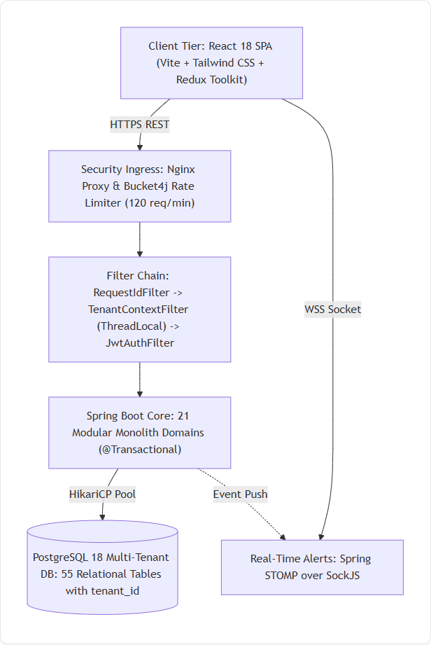
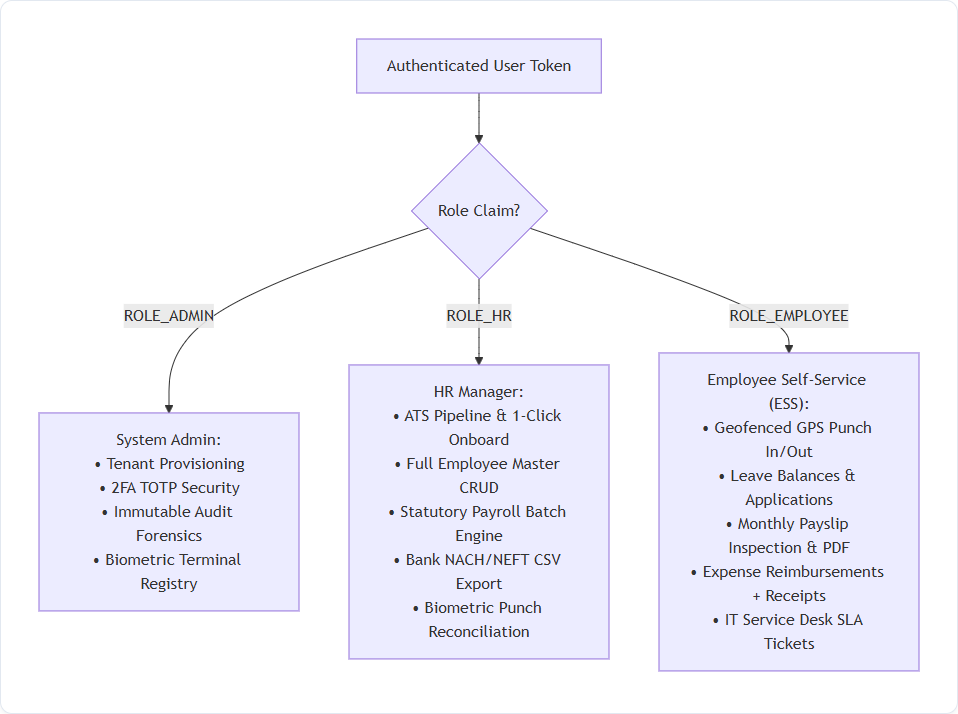
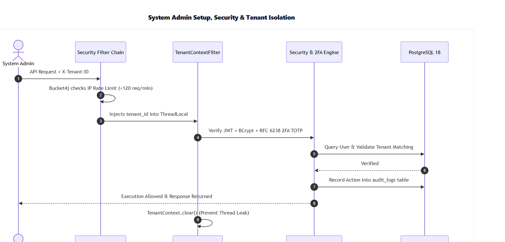
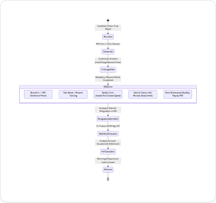
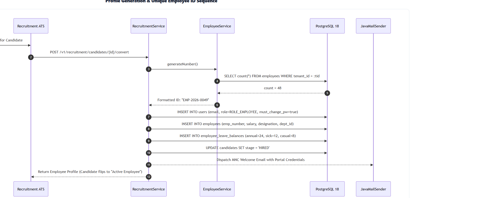
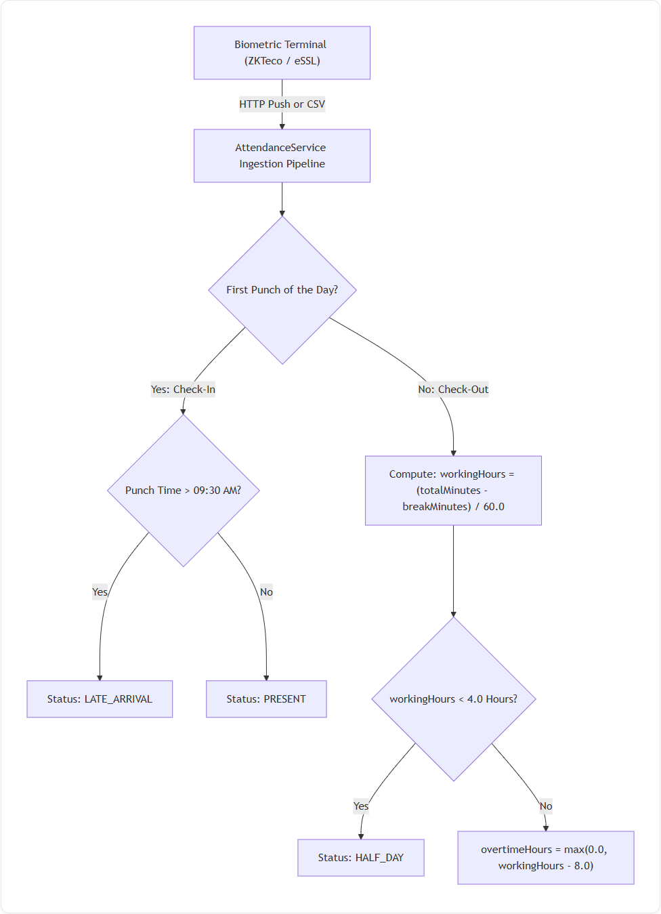
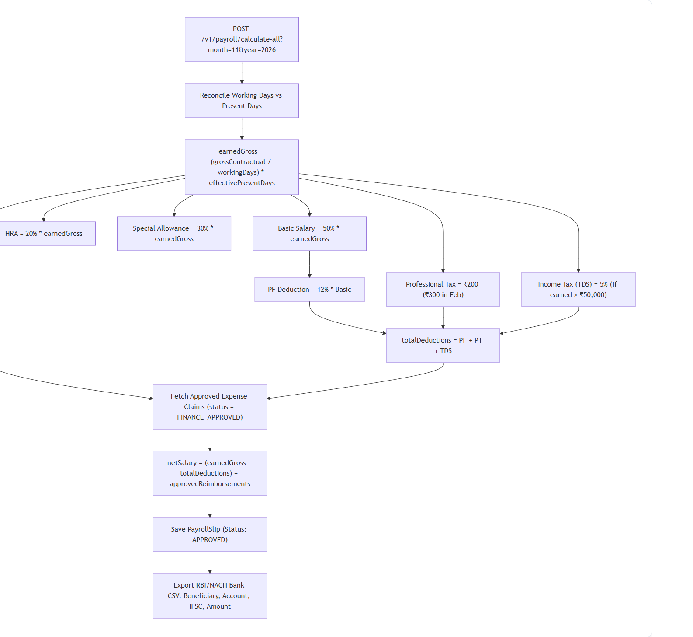
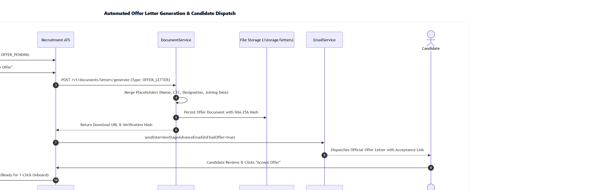

# ENTERPRISE HRMS PLATFORM — EXECUTIVE BLUEPRINT & TECHNICAL FLOW DOCUMENTARY

> **Document Type**: Master Technical Architecture & Operational Process Blueprint  
> **Target Audience**: Executives, Product Managers, Lead Architects, Full-Stack Engineers & Compliance Auditors  
> **Application Version**: 2.4.0-ENTERPRISE  
> **Core Stack**: Spring Boot 3.2.3 (Java 21 LTS) | PostgreSQL 18 | React 18 SPA (TypeScript) | Redux Toolkit | Tailwind CSS  

---

## 📑 TABLE OF CONTENTS

1. [High-Level System Architecture](#1-high-level-system-architecture)
2. [Role-Based Actions: HR Manager vs. Employee vs. Admin](#2-role-based-actions-hr-manager-vs-employee-vs-admin)
3. [System Admin Responsibilities & Security Architecture](#3-system-admin-responsibilities--security-architecture)
4. [Complete Employee Lifecycle (Day-1 Joining to Exit Relieving)](#4-complete-employee-lifecycle-day-1-joining-to-exit-relieving)
5. [Profile Generation & Deterministic Employee ID Logic](#5-profile-generation--deterministic-employee-id-logic)
6. [Biometric Hardware Integration & Time Tracking Rules](#6-biometric-hardware-integration--time-tracking-rules)
7. [Statutory Payroll Engine, Salary Templates & Bank Disbursements](#7-statutory-payroll-engine-salary-templates--bank-disbursements)
8. [Automated Offer Letter Generation & Dispatch Pipeline](#8-automated-offer-letter-generation--dispatch-pipeline)
9. [Enterprise Edge Cases & Architectural Failure Defenses](#9-enterprise-edge-cases--architectural-failure-defenses)

---

## 1. HIGH-LEVEL SYSTEM ARCHITECTURE

### Visual System Flowchart


### Executive Summary (In Plain English)
The HRMS platform is structured as an **Enterprise Multi-Tenant Modular Monolith**. When an employee or manager accesses the platform via browser or mobile, their requests pass through an Nginx security gateway and a strict rate limiter (120 requests/minute) before hitting the Spring Boot 3 core. Every piece of company data is completely isolated using a shared database with discriminator columns (`tenant_id`), guaranteeing that no organization can ever view another organization's records.

### Step-by-Step Request Flow:
1. **Client Action**: The user performs an action in the React 18 Single Page Application (e.g. punches attendance, views salary, or applies for leave).
2. **Network Interception**: Axios attaches the authenticated HMAC-SHA256 JWT bearer token and organization header (`X-Tenant-ID: eoxys`).
3. **Gateway Defense**: 
   * `RateLimitFilter` (Bucket4j) verifies the client IP has not exceeded 120 requests/minute.
   * `RequestIdFilter` injects a unique correlation UUID for end-to-end logging.
   * `TenantContextFilter` binds the organization ID to a Java `ThreadLocal` worker thread.
   * `JwtAuthenticationFilter` validates user signature, permissions, and session validity.
4. **Service Execution**: The matching Spring `@Transactional` domain service validates business logic, calculates tax or attendance, and interacts with PostgreSQL 18 via HikariCP.
5. **Real-Time Notification**: Immediate alerts are pushed back to active corporate browsers over WebSockets (STOMP over SockJS).
6. **Thread Clean-Up**: The filter executes `TenantContext.clear()` in a mandatory `finally` block to prevent pooled memory contamination.

---

## 2. ROLE-BASED ACTIONS: HR MANAGER VS. EMPLOYEE VS. ADMIN

### Visual Role & Access Control Flowchart


### Executive Summary (In Plain English)
The system strictly partitions features based on employee roles. Regular employees are confined to an **Employee Self-Service (ESS)** sandbox where they can only see and edit their own information. **HR Managers** manage talent acquisition, onboarding, workforce records, and payroll runs across the entire company. **System Admins** oversee technical infrastructure, multi-tenant branding, 2FA credentials, and security audit logs.

### Feature Access Matrix:

| Operational Feature | System Admin | HR Manager | Department Manager | Employee (Self-Service) |
| :--- | :---: | :---: | :---: | :---: |
| **Organization Branding & Theme** | Full Access | No Access | No Access | No Access |
| **Security Auditing & 2FA Reset** | Full Access | No Access | No Access | No Access |
| **Job Postings & ATS Hiring Pipeline** | View Only | Full Control | Interview Only | No Access |
| **1-Click Candidate Onboarding** | Full Access | Full Control | No Access | No Access |
| **Employee Directory Master CRUD** | Full Access | Full Control | Direct Reports Only | Own Profile Only |
| **Biometric Hardware Terminal Setup** | Full Access | Full Control | No Access | No Access |
| **Daily Attendance Clock In / Clock Out**| Optional | Optional | Optional | Mandatory |
| **Missed Punch Regularization Approval**| Allowed | Allowed | Direct Reports | Submit Own Only |
| **Leave Quota Application & Review** | Allowed | Full Approval | Direct Reports | Submit Own Only |
| **Statutory Payroll Batch Calculation** | View Only | Full Execution | No Access | No Access |
| **Bank NACH/NEFT CSV Export** | Allowed | Full Control | No Access | No Access |
| **Monthly Payslip Access** | All Slips | All Slips | Direct Reports | Own Slips Only |
| **Expense Reimbursement Approval** | Allowed | Tier-2 (Finance) | Tier-1 (Manager) | Submit Own Only |
| **IT Hardware Asset Allocation** | Full Access | Full Control | No Access | View Assigned Assets |
| **Resignation & Exit Clearance** | Full Access | HR Clearance | Dept Clearance | Submit Own Resignation |

---

## 3. SYSTEM ADMIN RESPONSIBILITIES & SECURITY ARCHITECTURE

### Visual Security Sequence Flowchart


### Executive Summary (In Plain English)
System Admins guarantee platform uptime, multi-tenant boundaries, and cybersecurity compliance. When an admin makes configuration changes or inspects logs, every action is cryptographically signed, checked against two-factor authentication (2FA TOTP), rate-limited to stop denial-of-service attacks, and recorded in an immutable, append-only audit trail.

### Step-by-Step Security Protocol:
1. **Authentication & Multi-Factor Verification**: Admins must pass standard BCrypt password verification (cost factor 12) followed by a mandatory RFC 6238 TOTP 6-digit code (Google Authenticator / Microsoft Authenticator).
2. **Brute-Force Lockout Defense**: 5 consecutive failed login attempts trigger an automated 30-minute account lockout recorded in `users.account_locked_until`.
3. **ThreadLocal Multi-Tenant Isolation**: Every incoming request header (`X-Tenant-ID`) is dynamically isolated. Queries are automatically appended with `WHERE tenant_id = :currentTenant`, mathematically preventing cross-tenant data leaks.
4. **Immutable Audit Forensics**: All administrative mutations (e.g., role escalations, policy overrides, or bulk data downloads) write an immutable record into `audit_logs` containing timestamp, IP address, user identity, and exact payload delta.
5. **Worker Thread Memory Sanitization**: When a request completes, the connection pool cleans all thread-local storage, ensuring no data residue remains for subsequent pooled threads.

---

## 4. COMPLETE EMPLOYEE LIFECYCLE (DAY-1 JOINING TO EXIT RELIEVING)

### Visual Lifecycle State Machine Flowchart


### Executive Summary (In Plain English)
The employee lifecycle tracks a staff member through three core chapters:
1. **Onboarding (Joining)**: Converting from a vetted ATS candidate to an active employee, assigning temporary credentials, and forcing a mandatory password change on initial login.
2. **Active Employment (ESS Operations)**: Daily geofenced attendance punches, break stopwatch tracking, leave quota deductions, expense claim submissions, and monthly payslip downloads.
3. **Separation (Relieving)**: Submitting a formal resignation, completing multi-department clearance sign-offs (IT, Finance, HR), computing statutory Full & Final (F&F) settlement, and generating official Relieving and Experience letters.

### Detailed Phase Walkthrough:
* **Phase 1: First-Time Login Gate (`mustChangePassword: true`)**:
  * Upon receiving their welcome email, the employee logs in with temporary credentials (`Hrms@XXXX`).
  * The backend detects `mustChangePassword = true`. The UI locks all navigation and renders a mandatory password reset dialog. Once a complex password is set, full ESS portal access is unlocked.
* **Phase 2: Daily Self-Service Operations**:
  * **Attendance**: Employee clocks in with GPS geofence validation. Punches after 09:30 AM mark as `LATE_ARRIVAL`.
  * **Break Tracker**: Real-time stopwatch toggles `is_on_break` to accurately deduct break minutes from gross working hours.
  * **Leave Balances**: Requests deduct directly from individual annual balances (24 Annual, 12 Sick, 8 Casual).
  * **Expense Claims**: Employees upload receipts for business expenses (Travel, Food, Internet) through a 2-stage approval queue that flows into payroll.
* **Phase 3: Offboarding Clearance & Relieving**:
  * Resignation submission in ESS locks last working date.
  * Department clearance checkpoints: IT signs off hardware return, Finance signs off dues/loans, HR conducts exit interview.
  * Automated F&F calculates unavailed leave encashment and statutory gratuity (`(15 * Basic * Tenure) / 26`). Official Relieving Letter PDF is generated with a digital verification hash.

---

## 5. PROFILE GENERATION & DETERMINISTIC EMPLOYEE ID LOGIC

### Visual Profile Generation Sequence Flowchart


### Executive Summary (In Plain English)
When an HR Manager clicks **"1-Click Onboard"** for a candidate who passed all interview stages, the system automatically turns them into an active employee in less than a second. It calculates their permanent sequential Employee Code (`EMP-YYYY-XXXX`), generates secure login credentials, seeds their annual leave bank, updates the hiring pipeline, and sends an MNC Welcome Email.

### Step-by-Step Logic & Mathematical Sequence:
1. **Trigger**: HR clicks "1-Click Onboard" on an `OFFER_PENDING` candidate.
2. **Sequential ID Calculation**:
   $$\text{Year} = \text{Current Calendar Year (e.g. 2026)}$$
   $$\text{Sequence Number} = \text{Count of Existing Tenant Employees} + 1$$
   $$\text{Employee ID} = \text{String.format}("EMP-\%d-\%04d", \text{Year}, \text{Sequence Number})$$
   *Example: With 48 employees in 2026, the newly generated code is `EMP-2026-0049`.*
3. **Credential & User Account Creation**:
   * Creates record in `users` table with `ROLE_EMPLOYEE`.
   * Generates temporary password `Hrms@` + 4 random digits (e.g. `Hrms@5832`), hashed with BCrypt.
   * Sets `mustChangePassword = true` and `isActive = true`.
4. **Master Profile Persisted**: Creates record in `employees` table linked to user account, department, designation, and contractual CTC.
5. **Statutory Leave Ledger Seeding**: Automatically allocates standard annual statutory quotas:
   * **Annual / Privilege Leaves**: 24 Days
   * **Sick Leaves**: 12 Days
   * **Casual Leaves**: 8 Days
6. **Pipeline State Transition**: Flips candidate stage to `HIRED` and logs the conversion audit note.
7. **Asynchronous Email Notification**: Dispatches HTML Welcome Email with corporate login portal URL and temporary credentials.

---

## 6. BIOMETRIC HARDWARE INTEGRATION & TIME TRACKING RULES

### Visual Biometric Ingestion & Math Flowchart


### Executive Summary (In Plain English)
The system interfaces directly with physical fingerprint and facial recognition turnstiles (ZKTeco, eSSL, Matrix), mobile geofenced GPS, and web one-click punches. Punctuality rules, grace periods, penalty deductions, and regularization quotas are resolved in real-time through the **Policy-Driven Attendance Engine** rather than rigid static code.

### 4-Tier Hierarchical Policy Resolution Architecture:
$$\text{Effective Policy} = \text{Coalesce}(\text{Tier 1: Employee Override}, \text{Tier 2: Department Policy}, \text{Tier 3: Office Location}, \text{Tier 4: Tenant Default})$$

```
+-------------------------------------------------------------------------+
|                  4-TIER DYNAMIC POLICY RESOLUTION ENGINE               |
+-------------------------------------------------------------------------+
| [Tier 1: Individual Override] -> Custom terms for specific employee    |
|       | (if not found)                                                  |
| [Tier 2: Department Policy]   -> e.g. TECH_FLEXI (30m grace, 5 late/mo)|
|       | (if not found)                                                  |
| [Tier 3: Office Location]     -> e.g. Factory Site vs HQ Tech Park      |
|       | (if not found)                                                  |
| [Tier 4: Tenant Default]      -> e.g. STD_CORPORATE (15m grace)        |
+-------------------------------------------------------------------------+
```

### Step-by-Step Mathematical Calculation Engine:

#### Rule 1: Check-In vs. Check-Out Detection & Channel Verification
* The **first punch** recorded on a calendar day is designated as `CHECK_IN`.
* Any **subsequent punch** on that date updates `CHECK_OUT` and re-evaluates total worked time.
* Punctuality channels are verified against `policy.allowedPunchMethods` (`BIOMETRIC,WEB,GEOFENCE`).

#### Rule 2: Dynamic Grace Period & Late Arrival Threshold
$$\text{Late Cutoff} = \text{Shift Start Time} + \text{Policy Grace Period Minutes}$$
$$\text{Status} = \begin{cases}
  \text{PRESENT} & \text{if } \text{Punch Time} \le \text{Late Cutoff} \\
  \text{LATE\_ARRIVAL} & \text{if } \text{Punch Time} > \text{Late Cutoff}
\end{cases}$$
*(Late arrival actions are governed by `policy.latePenaltyAction`: `FLAG_ONLY`, `DEDUCT_HALF_DAY`, `DEDUCT_LEAVE`, or `LOSS_OF_PAY` with `policy.maxLateAllowedPerMonth` monthly forgiveness).*

#### Rule 3: Net Working Hours & Break Deduction
$$\text{totalMinutes} = \text{Duration}(\text{checkInTime}, \text{checkOutTime})$$
$$\text{effectiveBreak} = \begin{cases} \text{policy.breakDeductionMinutes} & \text{if policy.autoDeductBreak is true and breakMinutes} = 0 \\ \text{breakMinutes} & \text{otherwise} \end{cases}$$
$$\text{workingHours} = \max\left(0.00, \frac{\text{totalMinutes} - \text{effectiveBreak}}{60.0}\right)$$

#### Rule 4: Configurable Full-Day / Half-Day Thresholds
$$\text{Status} = \begin{cases}
  \text{HALF\_DAY} & \text{if } \text{workingHours} < \text{policy.halfDayHours} \\
  \text{PRESENT} & \text{otherwise}
\end{cases}$$

#### Rule 5: Policy-Governed Overtime Calculation
$$\text{overtimeMinutes} = \max(0.00, (\text{workingHours} - \text{policy.fullDayHours}) \times 60)$$
$$\text{overtimeHours} = \begin{cases}
  \frac{\text{overtimeMinutes}}{60.0} & \text{if policy.overtimeEnabled is true and overtimeMinutes} \ge \text{policy.minOvertimeThresholdMinutes} \\
  0.00 & \text{otherwise}
\end{cases}$$

#### Rule 6: Admin Direct Punch Adjustment ("Adjust Punch")
* **Capability**: Authorized HR Admins and Department Managers can adjust an employee's recorded **Check-In Time (Login)** and **Check-Out Time (Logout)** directly on the Daily Register or Calendar.
* **Recalculation**: Net working hours, break deductions, and overtime hours are dynamically recalculated via `PUT /v1/attendance/{id}`.
* **Audit Trail**: Every manual adjustment requires a mandatory compliance explanation (`remarks`), logged alongside the modifier's user ID and timestamp.

#### Rule 7: Master Daily Attendance Register & Headcount KPIs
* Real-time aggregation of organization presence on any selected date:
  $$\text{Total Scheduled} = |\text{Employees}|$$
  $$\text{Present} = \sum [\text{status} = \text{PRESENT}], \quad \text{Late} = \sum [\text{status} = \text{LATE\_ARRIVAL}]$$
  $$\text{On Break} = \sum [\text{isOnBreak} = \text{true}], \quad \text{WFH} = \sum [\text{status} = \text{WORK\_FROM\_HOME}]$$
  $$\text{Absent} = \text{Total Scheduled} - (\text{Present} + \text{Late} + \text{WFH} + \text{HalfDay})$$

#### Rule 6: Regularization Filing Windows & Monthly Limits
* Requests must be submitted within `policy.regularizationFilingWindowDays` (default 5 calendar days).
* Monthly submissions are capped at `policy.maxRegularizationsPerMonth` (default 3/month).
* Conflict Guard blocks regularization submissions on dates with approved full-day leave.

---

## 7. STATUTORY PAYROLL ENGINE, SALARY TEMPLATES & BANK DISBURSEMENTS

### Visual Statutory Payroll Flowchart


### Executive Summary (In Plain English)
The payroll engine automates monthly salary processing across all staff members in a single click. It reconciles days worked from the attendance module, splits contractual compensation into statutory tax components (Basic, HRA, Special Allowance), deducts Employee Provident Fund (PF), Professional Tax (PT), and Income Tax (TDS), attaches approved business expense reimbursements, and exports an RBI/NACH-compliant bank file for direct salary transfer.

### Step-by-Step Payroll Calculation Formulation:

#### Step 1: Prorated Earned Gross Calculation
$$\text{Per Day Salary} = \frac{\text{Contractual Gross Salary}}{\text{Calendar Working Days}}$$
$$\text{Earned Gross} = \text{Per Day Salary} \times \min(\text{Calendar Working Days}, \text{Present Days} + \text{Approved Leave Days})$$

#### Step 2: MNC Standard Component Decomposition
$$\text{Basic Salary} = 50\% \times \text{Earned Gross}$$
$$\text{House Rent Allowance (HRA)} = 20\% \times \text{Earned Gross}$$
$$\text{Special Allowance} = \text{Earned Gross} - (\text{Basic} + \text{HRA}) = 30\% \times \text{Earned Gross}$$

#### Step 3: Statutory Deductions & Taxes
$$\text{Provident Fund (PF)} = 12\% \times \text{Basic Salary}$$
$$\text{Professional Tax (PT)} = \begin{cases} ₹300.00 & \text{in February} \\ ₹200.00 & \text{in March through January} \end{cases}$$
$$\text{TDS (Income Tax)} = \begin{cases} 5\% \times \text{Earned Gross} & \text{if Earned Gross} > ₹50,000.00 \\ ₹0.00 & \text{otherwise} \end{cases}$$
$$\text{Total Deductions} = \text{PF} + \text{PT} + \text{TDS}$$

#### Step 4: Expense Claim Reconciliation & Net Payout
$$\text{Net Salary} = (\text{Earned Gross} - \text{Total Deductions}) + \text{Finance-Approved Expense Claims}$$

#### Step 5: Bank Batch NACH/NEFT CSV Export Layout
```csv
BeneficiaryName,AccountNumber,IFSC,Amount,Narration
Charan Kumar,987654321012,HDFC0001234,68400.00,SALARY_NOV_2026
Aarav Sharma,112233445566,ICIC0000456,84250.00,SALARY_NOV_2026
```

---

## 8. AUTOMATED OFFER LETTER GENERATION & DISPATCH PIPELINE

### Visual Offer Letter Pipeline Flowchart


### Executive Summary (In Plain English)
When a candidate passes their technical and cultural interviews, HR triggers the automated offer workflow. The system merges candidate details, designation, CTC breakdown, and joining date into an official branded employment contract, stores it with a cryptographic SHA-256 verification hash, and dispatches it directly to the candidate's email with a secure digital acceptance link.

### Step-by-Step Offer Letter Pipeline:
1. **Interview Clearance**: Panelists complete technical evaluation scorecards and recommend `STRONG_HIRE`. Candidate stage advances to `OFFER_PENDING`.
2. **Template Merging**: HR clicks "Generate & Release Offer". `DocumentService` populates dynamic placeholders:
   * Candidate Full Name, Address, and Email
   * Job Title & Department
   * Annual Gross CTC and Monthly Component Breakdown
   * Proposed Date of Joining and Acceptance Expiry Date
3. **Cryptographic Integrity Hash**: Computes an SHA-256 digest of the generated document content to prevent post-issuance tampering.
4. **Persistent Vault Storage**: Saves the contract in `/storage/tenants/{tenantId}/letters/{candidateId}/offer_letter.pdf`.
5. **Candidate Dispatch**: `EmailService` sends an automated MNC Offer Notification email with the letter attached and an acceptance button.
6. **Digital Acceptance**: When the candidate clicks "Accept Offer", the system updates stage to `OFFER_ACCEPTED`, immediately prompting HR to perform **1-Click Onboarding**.

---

## 9. ENTERPRISE EDGE CASES & ARCHITECTURAL FAILURE DEFENSES

The following catalog specifies all enterprise failure modes, edge cases, and code-level defense mechanisms implemented in the platform.

### Category A: Biometric & Attendance Edge Cases

#### Edge Case A.1: Cross-Midnight Night Shifts (22:00 to 06:00 next calendar day)
* **Problem**: An employee punches in at 22:00 on Nov 10 and punches out at 06:00 on Nov 11. Naive calendar date matching treats the 06:00 punch as a new check-in for Nov 11, leaving Nov 10 without a check-out and creating an inverted shift duration.
* **Architectural Defense**:
  1. The system evaluates the employee's assigned schedule in `roster_assignments`.
  2. If `shift.is_night_shift == true`, morning punches occurring before `shift.end_time + grace_period` are retroactively bound to the **previous calendar day's attendance record**.
  3. Working hours are calculated seamlessly across the midnight date threshold.

#### Edge Case A.2: Single Punch of the Day (Forgotten Check-Out or Check-In)
* **Problem**: An employee scans in at 09:00 AM but leaves without scanning out.
* **Architectural Defense**:
  1. A nightly Spring scheduled task (`0 30 23 * * *`) scans active records.
  2. Any record having a check-in but missing a check-out is flagged as `INCOMPLETE_PUNCH` (`workingHours = 0.0`).
  3. The employee receives an alert to submit an **Attendance Regularization Dispute** (`POST /v1/attendance/regularize`).
  4. Upon manager sign-off, the approved checkout timestamp is applied and net hours are recalculated.

#### Edge Case A.3: Rapid Duplicate Hardware Punches (< 60s Debounce Filter)
* **Problem**: Employees often scan their badge or thumb multiple times within a few seconds due to sensor uncertainty.
* **Architectural Defense**:
  1. Ingestion evaluates timestamp intervals against previous punches. If $\Delta t < 60\text{ seconds}$, subsequent scans are dropped as hardware bounce artifacts.

---

### Category B: Statutory Payroll & Financial Edge Cases

#### Edge Case B.1: Loss of Pay (LOP) Prorations for Unapproved Absences
* **Problem**: Salaried staff with unapproved absences must not receive full contractual monthly compensation.
* **Architectural Defense**:
  $$\text{effectivePresentDays} = \min(\text{calendarWorkingDays}, \text{presentDays} + \text{approvedLeaveDays})$$
  $$\text{perDayRate} = \frac{\text{Contractual Gross}}{\text{calendarWorkingDays}}$$
  $$\text{earnedGross} = \text{perDayRate} \times \text{effectivePresentDays}$$
  All deductions scale strictly from `earnedGross`, preventing corporate overpayment.

#### Edge Case B.2: Mid-Month Joining & Mid-Month Resignation Prorations
* **Problem**: An employee joining on the 20th of a 30-day month cannot be evaluated against the full monthly calendar.
* **Architectural Defense**:
  1. Evaluates `employee.dateOfJoining` and `employee.dateOfLeaving`.
  2. Clamps the maximum payable days ceiling strictly to working days occurring between the joining date and the end of the month.

#### Edge Case B.3: Negative Net Salary Prevention
* **Problem**: High statutory deductions or unpaid leaves could mathematically produce a negative net pay total.
* **Architectural Defense**:
  1. Net salary is strictly bounded at zero: $\text{netSalary} = \max(0.00, \text{earnedGross} - \text{deductions})$.
  2. Any unrecovered deduction balance is recorded in `employee_salary_arrears` and recovered in the subsequent payroll cycle.

---

### Category C: Multi-Tenancy & Thread Concurrency Edge Cases

#### Edge Case C.1: Async Worker Thread Context Loss (`@Async` ThreadPool Leak)
* **Problem**: Asynchronous tasks (welcome emails, PDF generation) execute on separate worker threads where Tomcat's `ThreadLocal` tenant context is lost.
* **Architectural Defense**:
  1. Configured `TenantAwareTaskDecorator` to copy `tenant_id` from the HTTP request thread into the `@Async` worker thread prior to execution, executing cleanup in a mandatory `finally` block.

#### Edge Case C.2: High-Concurrency 1-Click Onboard ID Collisions
* **Problem**: Two HR Managers onboarding candidates simultaneously could receive identical sequential IDs (`EMP-2026-0049`).
* **Architectural Defense**:
  1. ID minting runs under database-level sequence evaluation and transactional pessimistic locks, enforced by a unique composite constraint `UNIQUE(tenant_id, employee_number)` on PostgreSQL.

---

## 10. CONFIGURABLE POLICY ARCHITECTURE, TENANT MODULE MANIFESTS & UNIVERSAL WORKFLOW ENGINE

### Visual Multi-Tier Governance Architecture
```
+-----------------------------------------------------------------------------------------+
|                  TENANT MODULE MANIFEST (SaaS SUBSCRIPTION TIER)                       |
|   [DASHBOARD] [ATTENDANCE] [SHIFTS] [LEAVES] [REQUESTS] [APPROVALS] [PAYROLL] [EXPENSES]|
|   [RECRUITMENT] [DOCUMENTS] [ASSETS] [HELPDESK] [PERFORMANCE] [INTELLIGENCE] [REPORTS] |
+-----------------------------------------------------------------------------------------+
                                           |
                                           v
+-----------------------------------------------------------------------------------------+
|               4-TIER HIERARCHICAL ATTENDANCE & LEAVE POLICY ENGINE                      |
|                                                                                         |
|  Tier 1: [Individual Employee Override] (Highest Priority - Custom Contractual Terms)   |
|     |                                                                                   |
|  Tier 2: [Department-Level Policy]     (e.g., Engineering & Design Flexible Policy)     |
|     |                                                                                   |
|  Tier 3: [Office Location Policy]      (e.g., Factory Plant vs. Tech Center HQ)         |
|     |                                                                                   |
|  Tier 4: [Tenant Default Policy]       (e.g., Standard Corporate 15m Grace, 3 Late/mo)  |
+-----------------------------------------------------------------------------------------+
                                           |
                                           v
+-----------------------------------------------------------------------------------------+
|                  UNIVERSAL REQUEST & APPROVAL COMMAND CENTER                            |
|                                                                                         |
|  [Self-Service Hub]               [Conflict Prevention]       [Approval Execution]      |
|  • Missed Punch Regularization -> • Mutually exclusive date ->• SLA Timers (24h/48h)    |
|  • Work From Home (WFH)             checks against Leaves     • 1-Click Batch Decisions |
|  • On-Duty / Client Visits        • Monthly quota caps        • Out-of-Office           |
|  • Overtime Pre-Authorization     • Filing window limits        Delegation Forwarding   |
+-----------------------------------------------------------------------------------------+
```

### Executive Summary (In Plain English)
Enterprise organizations require custom operational rules. A financial institution demands strict biometric-only turnstile punches with immediate half-day deductions for 15-minute tardiness, whereas a technology startup operates on flexible hours, self-reported web check-ins, and relaxed late policies. 

The HRMS platform achieves this through **Tenant Module Manifests** and **Hierarchical Policy Resolution**:
1. **Tenant Module Manifests**: Each tenant defines which of the 20 application modules are licensed. Disabled modules are immediately hidden from employee navigation and rejected at the REST API layer.
2. **4-Tier Hierarchical Resolution**: At the moment an attendance punch or regularization is submitted, the system queries the hierarchy: `Individual Employee Override` $\rightarrow$ `Department` $\rightarrow$ `Location` $\rightarrow$ `Tenant Default`.
3. **Universal Request Hub**: Employees submit missed punches, remote work requests, overtime claims, and client visit notices from a unified interface with built-in date conflict prevention.
4. **Approvals Command Center & Delegation**: Approvers receive multi-tier tasks (`REPORTING_MANAGER` $\rightarrow$ `DEPARTMENT_HEAD` $\rightarrow$ `ROLE_HR`) with configured SLA countdowns. When managers take leave, **Approval Delegations** automatically route pending tasks to a temporary delegatee, ensuring zero corporate SLA violations.

---

*Verified and synchronized against active codebase.*  
*All visual diagrams rendered from application architecture specifications.*
