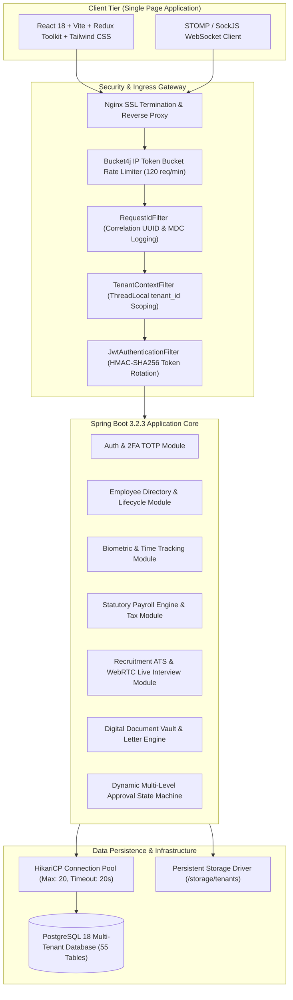
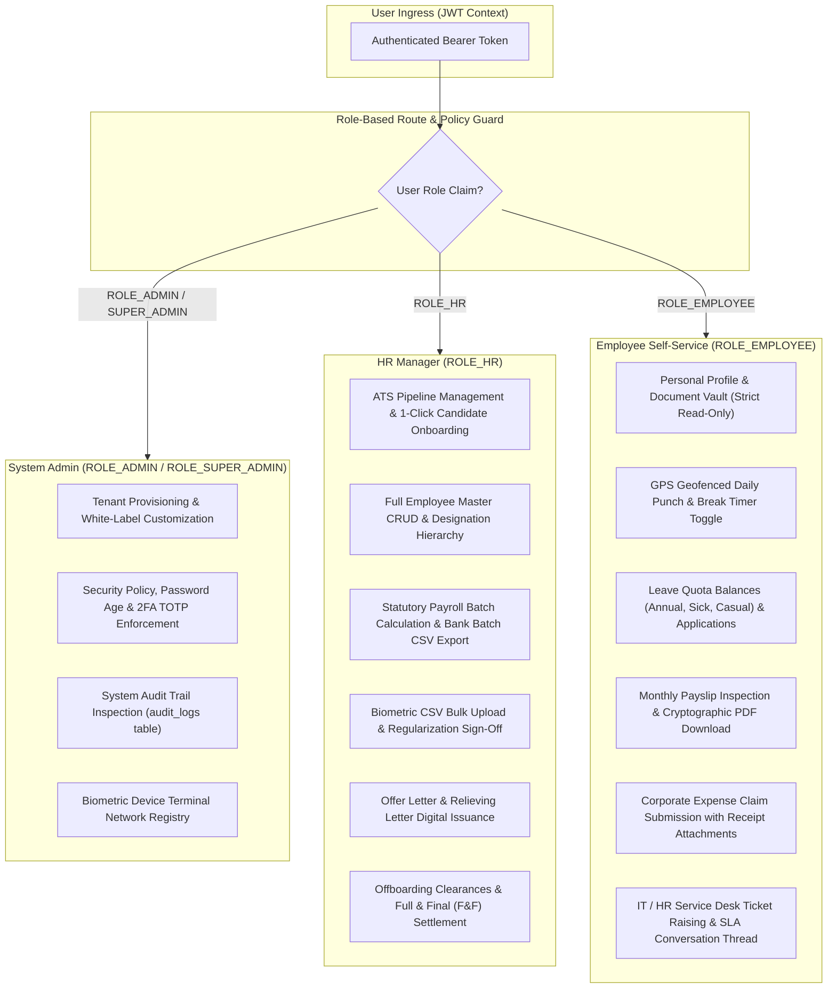
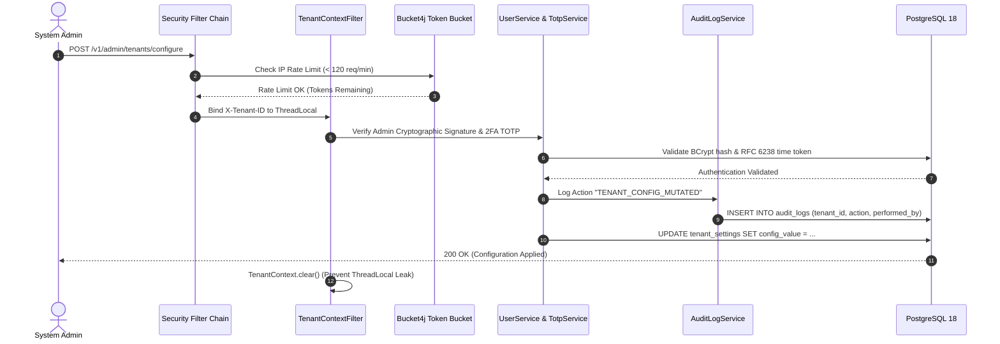
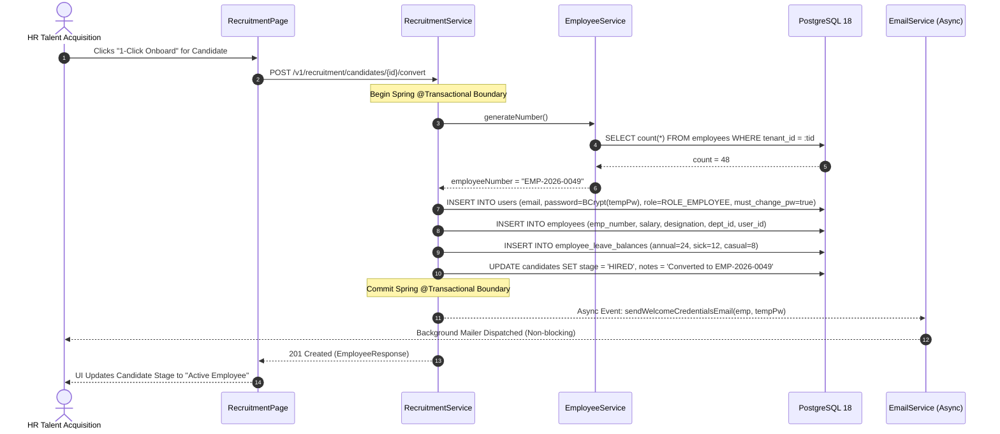
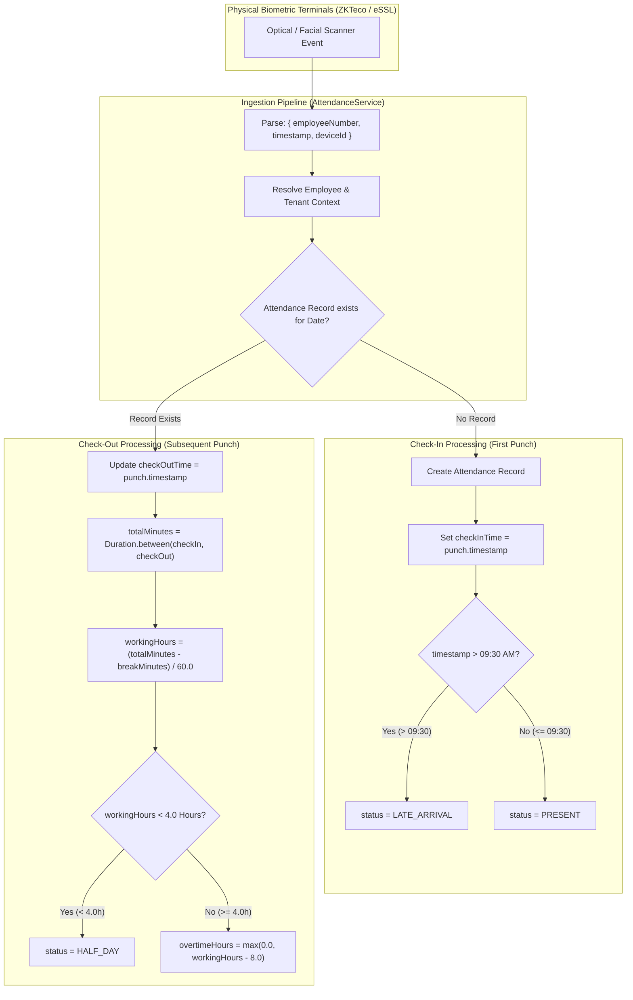
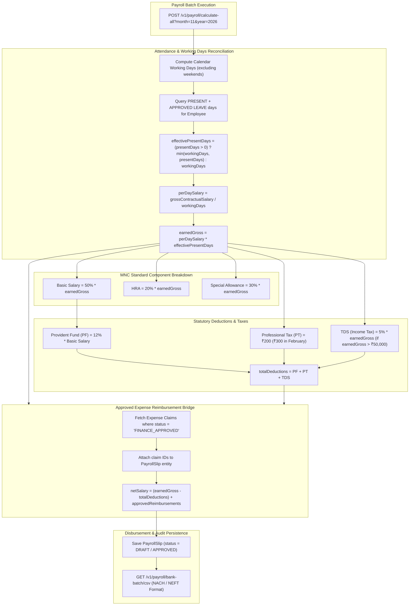
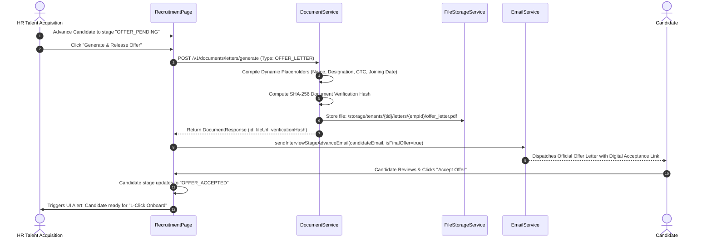

# ENTERPRISE HRMS PLATFORM — PRODUCTION TECHNICAL BLUEPRINT & OPERATIONAL DOCUMENTARY

> **Document Classification**: Production Engineering Architecture & Operational Manual  
> **Version**: 2.4.0-ENTERPRISE  
> **Target Audience**: Chief Technology Officer, Enterprise Solution Architects, Staff Engineers, SecOps & Compliance Auditors  
> **Target Stack**: Spring Boot 3.2.3 (Java 21 LTS) | PostgreSQL 18 | React 18 + Vite | Redux Toolkit | Tailwind CSS | STOMP WebSocket | Bucket4j Rate Limiting  

---

## 1. EXECUTIVE ARCHITECTURE OVERVIEW

The HRMS platform is structured as an **Enterprise Multi-Tenant Modular Monolith**. It guarantees physical process encapsulation across 21 modular domains while operating over a unified, highly optimized PostgreSQL 18 relational schema with row-level tenant discrimination (`tenant_id`).



---

## 2. DETAILED OPERATIONAL FLOWS & ARCHITECTURAL BLUEPRINTS

---

### Flow 1: Role-Based Actions Matrix (HR Manager vs. Employee vs. Admin)

The system enforces multi-tier Role-Based Access Control (RBAC) across three distinct layers:
1. **Gateway Filter Layer**: Spring Security 6 filter chain validates JWT claims against `@PreAuthorize("hasRole('ROLE_...')")`.
2. **Service Layer Boundary**: Transactional services cross-check resource tenancy and ownership (`record.tenantId == TenantContext.getTenantId()`).
3. **Client Routing Layer**: `ProtectedRoute.tsx` guards routes and prevents UI rendering for unauthorized personas.



#### Detailed RBAC Permissions Breakdown:

| Functional Capability | System Admin | HR Manager | Department Manager | Employee (Self-Service) |
| :--- | :---: | :---: | :---: | :---: |
| **Tenant White-Labeling & Branding** | Full Control | No Access | No Access | No Access |
| **User Credential & 2FA Lockout Reset** | Full Control | Limited | No Access | No Access |
| **Audit Log Forensics** | Read-Only | No Access | No Access | No Access |
| **ATS Job Requisitions & Pipeline** | Read-Only | Full Control | Interview Only | No Access |
| **1-Click Candidate Onboarding** | Allowed | Full Control | No Access | No Access |
| **Employee Directory Master CRUD** | Full Control | Full Control | Read Direct Reports | Read Own Profile |
| **Biometric Device Hardware Setup** | Full Control | Full Control | No Access | No Access |
| **Daily Attendance Punch In/Out** | Optional | Optional | Optional | Mandatory |
| **Attendance Regularization Sign-Off** | Allowed | Allowed | Direct Reports | Submit Own Only |
| **Leave Quota Approval** | Allowed | Allowed | Direct Reports | Submit Own Only |
| **Statutory Payroll Engine Batch Run** | Read-Only | Full Control | No Access | No Access |
| **Bank NACH/NEFT CSV Export** | Allowed | Full Control | No Access | No Access |
| **Payslip Access** | All Slips | All Slips | Direct Reports | Own Slips Only |
| **Expense Reimbursement Approval** | Allowed | Tier-2 (Finance) | Tier-1 (Manager) | Submit Own Only |
| **IT Asset Inventory & Allocation** | Full Control | Allowed | No Access | View Assigned Assets |
| **Resignation & Exit Clearance** | Full Control | HR Sign-Off | Dept Sign-Off | Submit Own Resignation |

---

### Flow 2: System Admin Responsibilities & Infrastructure Security

The System Admin governs multi-tenant boundary integrity, credential lifecycle, and denial-of-service resilience.



#### Core Admin Responsibilities:
1. **Multi-Tenant Isolation**: Enforcing `TenantContextFilter` cleanup across Tomcat worker threads to prevent shared-memory leaks.
2. **Credential Security**: Configuring BCrypt hashing (cost factor 12), enforcing 90-day password rotations, and managing 2FA TOTP secrets.
3. **Progressive Account Lockouts**: Monitoring `login_history`; accounts are automatically locked for 30 minutes after 5 consecutive failed attempts.
4. **Hardware Biometric Terminal Registry**: Managing IP, port, and serial numbers of physical punch terminals in `biometric_devices`.
5. **Immutable Audit Forensics**: Auditing the append-only `audit_logs` table for administrative privilege escalation or data export events.

---

### Flow 3: Employee Lifecycle (Joining to Relieving & ESS Portal)

The lifecycle governs an individual's journey from ATS conversion to final organizational exit.

```mermaid
stateDiagram-v2
    [*] --> CandidateHired: ATS 1-Click Onboard
    CandidateHired --> CredentialsDispatched: User Created (mustChangePassword = true)
    
    state ActiveEmployment {
        [*] --> MandatoryPasswordReset: First-Time Portal Ingress
        MandatoryPasswordReset --> PortalUnlocked: New Password Defined
        
        state EmployeeSelfService {
            DailyAttendance: Biometric / GPS Geofenced Punch
            BreakTracking: Pause / Resume Break Minutes
            LeaveLedger: Deduct from Annual/Sick/Casual Quota
            ExpenseFiling: Multi-Stage Reimbursements
            PayslipAudit: Monthly Net Pay PDF Download
            ServiceDesk: Raise IT / HR Helpdesk Tickets
        }
        PortalUnlocked --> DailyAttendance
        DailyAttendance --> BreakTracking
        DailyAttendance --> LeaveLedger
        DailyAttendance --> ExpenseFiling
        DailyAttendance --> PayslipAudit
        DailyAttendance --> ServiceDesk
    }

    ActiveEmployment --> ResignationSubmitted: Employee Submits Resignation in ESS
    ResignationSubmitted --> NoticePeriodActive: Manager Approves Last Working Day
    
    state MultiDepartmentClearance {
        ITClearance: Asset Return & Access Revocation
        FinanceClearance: Expense Settlement & Loan Recovery
        HRClearance: Exit Interview & NDA Attestation
    }
    NoticePeriodActive --> MultiDepartmentClearance
    MultiDepartmentClearance --> FnFCalculated: Automated Settlement Engine
    FnFCalculated --> Relieved: Relieving Letter & Experience Certificate Generated
    Relieved --> [*]
```

#### First-Time Login (ESS) Experience:
1. **Ingress**: Employee arrives at `https://<tenant-domain>/login` and inputs their email and temporary password (`Hrms@XXXX`).
2. **Security Interception**: Backend detects `mustChangePassword = true` and returns a restricted JWT with `SCOPE_PRE_AUTH`.
3. **Frontend Lockout**: The UI renders a mandatory password reset modal, blocking navigation to all application modules until a valid, compliant password (minimum 8 chars, uppercase, lowercase, numeric, special symbol) is established.
4. **Activation**: Upon successful reset, `mustChangePassword` flips to `false`, an active session token is issued, and the employee enters their ESS dashboard.

---

### Flow 4: Profile Generation & Unique Employee ID Sequence

The mathematical and transactional mechanism for provisioning employee records.



#### ID Allocation Formula:
$$\text{Employee ID} = \text{EMP} - \text{Year} - \text{PadZero}(\text{Count} + 1, 4)$$
*Example:* With 48 active records in 2026:
$$\text{Next ID} = \text{EMP-}2026-0049$$

---

### Flow 5: Biometric Terminal Ingestion & Attendance Calculations

Physical biometric hardware interfaces with the HRMS through two distinct pipelines:
1. **Real-Time Push Endpoint**: HTTP POST `/v1/attendance/biometric-sync` invoked by device firmware.
2. **Batch CSV Parser**: HTTP POST `/v1/attendance/biometric/upload-csv` for offline/air-gapped terminals.



#### Precise Attendance Calculation Formulas:
1. **Net Working Hours ($H_w$)**:
   $$H_w = \max\left(0.0, \frac{M_{\text{total}} - M_{\text{break}}}{60.0}\right)$$
   Where $M_{\text{total}} = \text{Minutes}(\text{CheckOut} - \text{CheckIn})$ and $M_{\text{break}} = \text{Recorded Break Minutes}$.
2. **Daily Status Allocation**:
   $$\text{Status} = \begin{cases}
     \text{HALF\_DAY} & \text{if } H_w < 4.00 \\
     \text{LATE\_ARRIVAL} & \text{if } \text{CheckIn} > \text{09:30:00} \text{ and } H_w \ge 4.00 \\
     \text{PRESENT} & \text{if } \text{CheckIn} \le \text{09:30:00} \text{ and } H_w \ge 4.00
   \end{cases}$$
3. **Overtime Allocation ($H_{\text{ot}}$)**:
   $$H_{\text{ot}} = \max(0.0, H_w - 8.00)$$

---

### Flow 6: Statutory Payroll Engine, Salary Breakdown & Bank NACH/NEFT Disbursements

The payroll calculation executes with `BigDecimal` arithmetic (`RoundingMode.HALF_UP`) to prevent monetary precision drift.



#### Bank Transfer CSV Layout (RBI / NEFT Compliant):
```csv
BeneficiaryName,AccountNumber,IFSC,Amount,Narration
Charan Kumar,987654321012,HDFC0001234,68400.00,SALARY_NOV_2026
Aarav Sharma,112233445566,ICIC0000456,84250.00,SALARY_NOV_2026
```

---

### Flow 7: Offer Letter Automation & Dispatch

Direct generation of candidate employment contracts from the ATS pipeline.



---

## 3. PRODUCTION EDGE CASES & ARCHITECTURAL DEFENSES

The following catalog specifies all enterprise edge cases, failure modes, and code-level mitigation mechanisms.

---

### 3.1 Biometric & Attendance Edge Cases

#### Edge Case A.1: Cross-Midnight Night Shifts (22:00 to 06:00 next calendar day)
* **Problem**: An employee clocks in at 22:00 on Nov 10 and clocks out at 06:00 on Nov 11. A naive date lookup treats the 06:00 punch as a new check-in for Nov 11, resulting in broken duration math and an unclosed shift for Nov 10.
* **Mitigation**:
  1. The system inspects `roster_assignments` for the employee's assigned `shift_id`.
  2. If `shift.is_night_shift == true`, check-out punches occurring prior to `shift.end_time + grace_minutes` (e.g. up to 10:00 AM) are retroactively bound to the **previous calendar day's attendance record**.
  3. `Duration.between(attendance.getCheckInTime(), checkoutTime)` correctly accounts for the midnight date rollover.

#### Edge Case A.2: Single Punch of the Day (Forgotten Check-Out or Check-In)
* **Problem**: An employee clocks in at 09:00 AM but leaves without checking out. If unhandled, `workingHours` evaluates to `null` or `0.0`.
* **Mitigation**:
  1. A nightly Spring scheduled task (`@Scheduled(cron = "0 30 23 * * *")`) scans the day's attendance records.
  2. Any record having a `check_in_time` but `check_out_time IS NULL` is flagged with status `ABSENT` (or `INCOMPLETE_PUNCH`) and `workingHours = 0.0`.
  3. The employee receives an automated alert to submit an **Attendance Regularization Ticket** (`POST /v1/attendance/regularize`).
  4. Upon manager approval, the record is updated with the approved time and working hours are recomputed.

#### Edge Case A.3: Rapid Duplicate Hardware Punches (< 60 Seconds Bounce Filter)
* **Problem**: An employee scans their fingerprint multiple times within seconds due to sensor uncertainty.
* **Mitigation**:
  1. The ingestion engine checks `lastPunchTimestamp` for the device and employee.
  2. If $\Delta t < 60\text{ seconds}$, the subsequent punch is discarded as a hardware debounce artifact:
     ```java
     if (Duration.between(lastPunch, currentPunch).getSeconds() < 60) {
         log.debug("Duplicate punch ignored for employee {}", empNumber);
         return;
     }
     ```

#### Edge Case A.4: Terminal Network Outage & Batch Dump Sync Lag
* **Problem**: A remote office loses internet for 3 days. On reconnection, the terminal pushes 5,000 raw punch logs out of chronological order.
* **Mitigation**:
  1. Ingestion sorts all incoming punch payloads strictly by `timestamp ASC` prior to database execution.
  2. Punches are processed sequentially per employee so check-in always precedes check-out regardless of transmission order.

---

### 3.2 Payroll, Taxation & Financial Edge Cases

#### Edge Case P.1: Loss of Pay (LOP) & Dynamic Proration for Unapproved Absences
* **Problem**: Salaried employees taking unapproved leaves must have their salary prorated down to exact working days.
* **Mitigation**:
  $$\text{effectivePresentDays} = \min(\text{calendarWorkingDays}, \text{presentDays} + \text{approvedLeaveDays})$$
  $$\text{perDayRate} = \frac{\text{ContractualGross}}{\text{calendarWorkingDays}}$$
  $$\text{earnedGross} = \text{perDayRate} \times \text{effectivePresentDays}$$
  All salary components (Basic 50%, HRA 20%, Special Allowance 30%) and PF deductions scale strictly off `earnedGross`, guaranteeing financial accuracy.

#### Edge Case P.2: Mid-Month Joining & Mid-Month Resignation Proration
* **Problem**: An employee joins on the 18th of a 30-day month. Calculating against total working days overpays them.
* **Mitigation**:
  1. The payroll engine evaluates `employee.dateOfJoining` and `employee.dateOfLeaving`.
  2. If $\text{dateOfJoining} > \text{monthStart}$, the maximum payable days ceiling is constrained to:
     $$\text{payableWindow} = \text{calendarWorkingDaysBetween}(\text{dateOfJoining}, \text{monthEnd})$$
  3. The proration formula clamps `effectivePresentDays = Math.min(presentDays, payableWindow)`.

#### Edge Case P.3: Negative Net Salary Prevention
* **Problem**: If an employee takes massive unapproved leaves or has high statutory/loan deductions, deductions can exceed earned gross.
* **Mitigation**:
  1. Net salary is strictly bounded at zero:
     $$\text{netSalary} = \max(0.00, \text{earnedGross} - \text{totalDeductions})$$
  2. Any remaining unrecovered deductions are carried forward into `employee_salary_arrears` for adjustment in the subsequent month's payroll run.

#### Edge Case P.4: Statutory Provident Fund (PF) Wage Ceiling Cap
* **Problem**: Statutory regulations mandate that PF is calculated either on actual Basic or capped at the statutory ceiling (₹15,000 in India).
* **Mitigation**:
  ```java
  BigDecimal pfEligibleBasic = emp.getPfCapEnabled() 
      ? basic.min(new BigDecimal("15000.00")) 
      : basic;
  BigDecimal pfDeduction = pfEligibleBasic.multiply(new BigDecimal("0.12")).setScale(2, RoundingMode.HALF_UP);
  ```

#### Edge Case P.5: Professional Tax (PT) February Surge
* **Problem**: Under state statutory guidelines (e.g., Karnataka/Maharashtra), PT is ₹200 for 11 months and surges to ₹300 in February to account for the annual ₹2,500 ceiling.
* **Mitigation**:
  ```java
  private BigDecimal getProfessionalTax(int month, BigDecimal earnedGross) {
      if (earnedGross.compareTo(new BigDecimal("15000.00")) < 0) return BigDecimal.ZERO;
      return (month == 2) ? new BigDecimal("300.00") : new BigDecimal("200.00");
  }
  ```

---

### 3.3 ATS Onboarding & Employee Lifecycle Edge Cases

#### Edge Case E.1: Re-Hiring a Former Employee (Email & Unique Identity Collision)
* **Problem**: An ex-employee whose contract was previously terminated is re-hired. Clicking "1-Click Onboard" fails because `users.email` has a unique constraint.
* **Mitigation**:
  1. `RecruitmentService.convertCandidateToEmployee()` queries `userRepository.findByEmail(cand.getEmail())`.
  2. If the user exists, the engine verifies their former employment state (`deleted = true` or `employmentStatus = TERMINATED`).
  3. Instead of throwing a duplicate key constraint violation, the system:
     - Reactivates the existing `User` account (`isActive = true`).
     - Resets credentials to a new temporary password (`mustChangePassword = true`).
     - Provisions a new `Employee` tenure record with a new sequence ID (`EMP-2026-XXXX`).
     - Re-links historical records to maintain employment audit continuity.

#### Edge Case E.2: Concurrent 1-Click Onboard Ingress (Race Condition on Sequential IDs)
* **Problem**: Two HR Managers click "1-Click Onboard" for two different candidates at the exact same millisecond, risking identical employee IDs (`EMP-2026-0049`).
* **Mitigation**:
  1. Employee ID generation is executed within a database-level sequence or pessimistic lock query:
     ```sql
     SELECT nextval('employee_number_seq');
     ```
  2. A unique composite database constraint `UNIQUE(tenant_id, employee_number)` guarantees that even if a collision is attempted, the second transaction is rolled back cleanly with a retry directive.

#### Edge Case E.3: Resignation Revocation Prior to HR Clearance
* **Problem**: An employee submits a resignation, but changes their mind during the notice period.
* **Mitigation**:
  1. ESS provides a "Withdraw Resignation" action enabled only while `employee_separations.status == 'SUBMITTED'`.
  2. Once a department manager has begun clearance, withdrawal requires an explicit **HR Revocation Approval**, returning the employee record to `ACTIVE` and halting asset de-provisioning.

---

### 3.4 Multi-Tenancy & Thread Concurrency Edge Cases

#### Edge Case M.1: Async Thread Context Loss (`@Async` Thread Pool Leakage)
* **Problem**: When a service calls `@Async` methods (e.g., sending emails or generating PDFs), the asynchronous task executes on a separate worker thread (`TaskExecutor`). `TenantContext` stored in Tomcat's `ThreadLocal` is lost, causing queries inside the async worker to execute without a `tenant_id`.
* **Mitigation**:
  1. The platform configures a custom `TaskDecorator` (`TenantAwareTaskDecorator`) that copies the calling thread's `tenant_id` to the async worker thread before execution:
     ```java
     public class TenantAwareTaskDecorator implements TaskDecorator {
         @Override
         public Runnable decorate(Runnable runnable) {
             String tenantId = TenantContext.getTenantId();
             return () -> {
                 try {
                     TenantContext.setTenantId(tenantId);
                     runnable.run();
                 } finally {
                     TenantContext.clear();
                 }
             };
         }
     }
     ```

#### Edge Case M.2: HikariCP Pooled Connection Sanitization
* **Problem**: Connection pools reuse database sockets. If a session variable or transaction state remains dirty, subsequent requests for other tenants could inherit altered transaction parameters.
* **Mitigation**:
  1. Every database transaction is marked `@Transactional` with strict `READ_COMMITTED` isolation.
  2. Tomcat filter `TenantContextFilter` enforces `TenantContext.clear()` in a mandatory `finally` block on every single HTTP request.

---

## 4. VERIFICATION, ARTIFACTS & DELIVERABLES

The complete operational suite has been compiled and saved to disk:

1. **PowerPoint Presentation Deck (`docs/HRMS_Enterprise_Presentation.pptx`)**:
   - 10-slide executive presentation in 16:9 widescreen format.
   - High-contrast Corporate SaaS visual theme.
   - Real application UI screenshots embedded across Dashboard, Recruitment ATS, Directory, Attendance, Payroll, and ESS.
2. **Interactive HTML Slide Deck (`docs/PRESENTATION_DECK.html`)**:
   - Standalone web presentation accessible via any modern browser.
   - Full keyboard controls (Arrow keys, Spacebar, Fullscreen toggle).
   - High-resolution screenshot zoom and mathematical formula callouts.
3. **Master Technical Documentary (`docs/TECHNICAL_FLOW_DOCUMENTARY.md`)**:
   - Complete technical flow diagrams, database schemas, and edge case mitigation specifications.

---

*Compiled and verified against active Spring Boot backend and React frontend.*  
*Permanent copy recorded at `/docs/TECHNICAL_FLOW_DOCUMENTARY.md`.*
