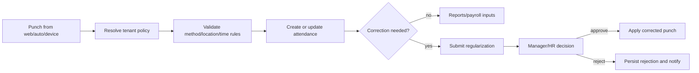

# End-to-end Workflow Audit

## Test status

The following diagrams are reconstructed from controller/service code and DTOs. They are **source-derived scenarios**, not claims that the workflow passed a live test. Backend/API/database execution was blocked by the absence of Maven and a designated disposable database. Frontend login E2E attempts are recorded in [TEST_COVERAGE_REPORT.md](TEST_COVERAGE_REPORT.md).

## Employee sign-in and account lifecycle

```mermaid
sequenceDiagram
  participant B as Browser
  participant A as AuthController/AuthService
  participant T as TenantContextFilter
  participant DB as User/RefreshToken repositories
  B->>T: POST /api/v1/auth/login + credentials + tenant header
  T->>A: Resolve tenant from request before authentication
  A->>DB: Find user by email; authenticate password
  A->>A: Build JWT using current TenantContext
  A->>DB: Save refresh token and login history
  A-->>B: AuthResponse plus refresh cookie
  B->>B: Store access/refresh tokens in localStorage
```

**Static finding:** `TenantContextFilter` accepts a client tenant header/query value; `AuthService.login` resolves the account by email without an evident user-tenant equality check; `JwtUtils.generateToken` places `TenantContext.getTenantId()` in the tenant claim. This creates a high-risk tenant-switch path. Do not test against a real tenant. Controlled regression: create two disposable tenants, log in as a tenant-A account with tenant-B context, and assert issuance is rejected before any tenant-B data request.

Reset flows are email verification/resend and OTP reset. TOTP challenge is checked by login when `User.totpEnabled` is true. MFA setup, enable and disable routes are under `/v1/auth/**`, which is permit-all. Login history accepts a target `userId`; access and disclosure behavior require a security fix and controlled test.

## Employee self-service and HR administration

1. HR/Admin creates a record through `POST /api/v1/employees` and `EmployeeService` creates the linked profile/account path.
2. Employees and administrators use profile/directory endpoints; profile photo and employee-document uploads are handled by `EmployeeService`.
3. Updates and soft deletion are present.

`GET /api/v1/employees/{id}` is permitted to any authenticated user by the route configuration, and `EmployeeService.getById` resolves by numeric ID. Verify owner and tenant scope. UI route hiding is not sufficient. Profile uploads include a separate ownership check in service code, but must also bind the employee record to the active tenant.

## Attendance, policy and regularization



Source includes regularization, device/CSV ingestion, geofence and tiered policy resolution. No real device integration was found. Test duplicate punch, late/night shift boundaries, tenant-specific policy precedence, malicious device IDs, policy assignment with a foreign-tenant entity ID, approval replay and concurrent regularizations.

## Leave and generic requests

Leave flow: employee submits → service validates request → pending leave is persisted → manager/HR or workflow decision → approval/rejection updates status → approval may adjust a matching balance → notification. `WorkflowEngineService` updates leave and attendance regularization completion paths. The balance update is conditional on finding a matching balance, so missing-balance behavior needs explicit test/owner decision.

Generic request flow: authenticated caller supplies employee ID and request fields → `EmployeeRequestService` creates PENDING request → configured workflow may start, but exceptions are caught and manual review is enabled → review endpoint accepts an `action` string → status is written directly. Current code does not constrain that action to an allowed state transition. The request's employee ID and request ID are not consistently tenant/owner-bound.

Test cancellation, reject/resubmit, already-approved requests, duplicates, overlapping leave/WFH/ON_DUTY, stale reviewer decision, arbitrary status value and two simultaneous approvals. No such scenarios were run.

## Workflow definitions, approvals and delegation

```mermaid
flowchart TD
  D[Resolve active tenant/module definition] --> I[Create PENDING instance]
  I --> A[Notify first step (currently log-oriented)]
  A --> R[Authenticated role submits decision]
  R --> X{APPROVED or REJECTED?}
  X -- approved, more steps --> N[Advance step]
  N --> A
  X -- final approval --> C[Complete linked domain action]
  X -- rejected --> C
  C --> F[Update domain state and notify where implemented]
```

`WorkflowStep.approverRole` is represented in the workflow model, but `processApproval` does not visibly enforce that the caller is the configured user/role for the active step. It loads `WorkflowInstance` by ID rather than tenant+ID. `getPendingTasksForUser` ignores its user argument and returns all pending instances for the tenant without pagination. SLA values exist in DTOs/entities, but deadline escalation was not demonstrated. Delegations are represented but target user tenant/role validity and application in approval resolution must be tested.

## Payroll

1. Authorized HR/Admin starts single or batch process.
2. `PayrollService` gathers employees and attendance and writes payroll slips.
3. HR can adjust/review/approve and mark paid.
4. Register, summaries, employee slips, bank batch export and client PDF utility are present.

No calculation result is certified by this audit. Verify formulas, rounding, tax declaration use, concurrency/duplicate runs, rollback, expense reimbursement linkage, bank export acceptance and sensitive payroll visibility. Migration V1 and default PostgreSQL/Flyway settings need reconciliation first.

## Recruitment and interview

Recruiter creates a job/candidate → updates stage/scorecards → schedules interview and panel → candidate obtains guest join token and joins signaling/video room → panel submits scorecards → candidate conversion endpoint may create employee onboarding records. `LiveKitTokenService` produces provider-compatible tokens, but provider account/reachability and actual media path were not tested. Verify expiry, guest token reuse, room authorization, panel membership, duplicate conversion, atomicity, credentials and email side effects.

## Documents, expenses and offboarding

- **Documents:** upload employee file/metadata → HR verification → download/acknowledgement/letter paths. Employee resume/photo storage also maps to `/uploads/**`, which is public in both Spring MVC static resources and Spring Security. Employee private data can be disclosed if stored under that path.
- **Expenses:** claim → manager review → finance review → status/reimbursement. Exact legal transition graph and payroll coupling are not verified.
- **Offboarding:** separation request → reviewer → clearance records → settlement calculate/save/query → final status/document output. Current source does not prove clearance completion gates or jurisdictional settlement correctness.

## Test checklist for all workflows

Every workflow requires positive, invalid-input, unauthorized-role, foreign-tenant/ID, duplicate, conflict, concurrency, downstream failure, rollback and notification-failure tests. Proposed cases and acceptance criteria are grouped by priority in [REMEDIATION_ROADMAP.md](REMEDIATION_ROADMAP.md). Current results must remain `NOT VERIFIED` until those tests run on a disposable environment.
