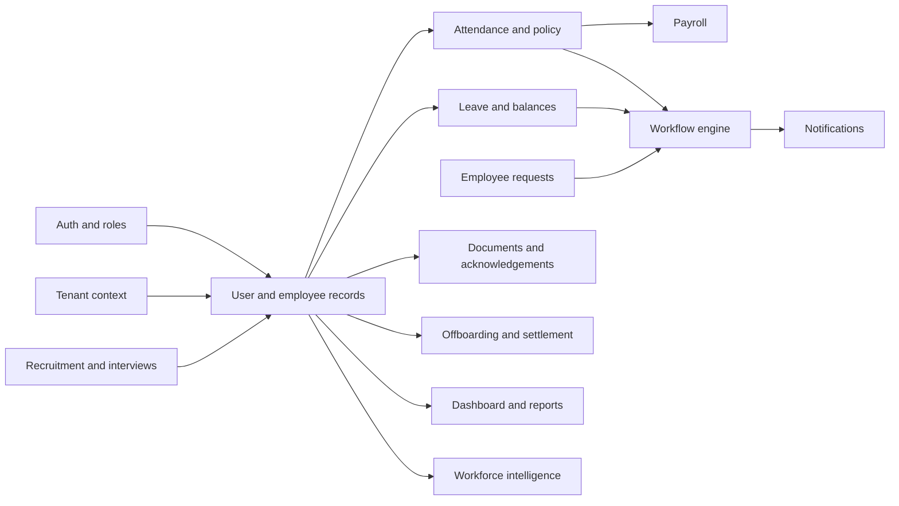

# Module-wise Audit

## Rating convention

`NOT VERIFIED` means runtime business behavior was not tested. `PARTIALLY WORKING` means a source surface exists and a subset of related paths has some evidence, but end-to-end behavior is incomplete or contradicted by static findings. `NOT IMPLEMENTED` means no corresponding application surface was found. No module is marked `PASS` on source inspection alone.

## Module audit matrix

| Module | Implemented source surfaces | Static assessment | Runtime status |
|---|---|---|---|
| Auth/account lifecycle | `AuthController`, `AuthService`, `JwtUtils`, refresh/login-history repositories, TOTP and email-verification services; registration/login/reset/change-password/refresh/logout/MFA routes. | Credential material in tracked configuration and startup/demo accounts. `/v1/auth/**` is permit-all, including TOTP and login-history endpoints; logout-all controller is a success stub. Refresh token is stored in browser localStorage and cookie is `secure(false)`. | **PARTIALLY WORKING**: frontend type/build pass; login Playwright checks fail against current UI; backend tests blocked. |
| Employee and profile | `EmployeeController`, `EmployeeService`, `Employee` entity, directory/detail/form/profile UI. | Create/update/delete role guards exist. `GET /employees/{id}` is authenticated but lacks owner check and service uses ID lookup. ID-based upload paths have owner checks in `EmployeeService` but are not tenant-bound. | **NOT VERIFIED** |
| Department | `DepartmentController/Service/Repository`, department screen. | Admin/HR guards on writes; tenant-scoped list patterns coexist with ID-based lookups. Manager/employee branch visibility not tested. | **NOT VERIFIED** |
| Attendance | `AttendanceController/Service`, punch/regularization/biometric/device/location repositories, attendance UI. | Web/auto punch, breaks, CSV/JSON ingestion, geofence and review paths exist. Endpoint ownership, device authentication, duplicate/concurrent punch behavior and payroll synchronization are unverified. | **NOT VERIFIED** |
| Attendance policy | Uncommitted `PolicyController`, `PolicyResolverService`, `AttendancePolicy` and `PolicyAssignment` model/repositories; policy UI/API. | Employee/department/location/default resolution exists. `assignPolicy` retrieves policy and target records by unscoped IDs before associating them with current tenant; verify tenant ownership. | **NOT VERIFIED** |
| Leave | `LeaveController`, `LeavePolicyController`, services, balance and policy entities, leave UI. | Apply/review/cancel/accrual surfaces exist. Approval completion can update balances. Review transitions and employee ownership/tenant constraints require service-level testing. | **NOT VERIFIED** |
| Employee requests | `EmployeeRequestController/Service`, request entity/DTOs and self-service UI. | Authenticated create/get operations accept caller-supplied employee IDs. Review writes `action.toUpperCase()` without a closed transition set; tenant/ownership scope is not applied to the loaded row. | **PARTIALLY WORKING**: source paths exist; authorization/state findings block acceptance. |
| Workflow/approvals | `WorkflowController`, `WorkflowEngineService`, definition/step/instance/approval/delegation entities and UI. | Sequential workflow code exists; decision path does not verify configured approver role/identity, loads instance by unscoped ID; inbox returns every pending instance for tenant and uses unpaged list with per-row reads. SLA/notification execution is not demonstrated. | **PARTIALLY WORKING** |
| Payroll | `PayrollController/Service`, `PayrollSlip`, payroll UI and PDF utility. | Process/review/adjust/approve/mark-paid/register/export surfaces exist. Statutory formula, idempotence, transaction boundaries, authorization and concurrent run safety not verified. V1 migration is MySQL-style vs PostgreSQL target. | **NOT VERIFIED** |
| Expenses | `ExpenseController`, `ExpenseServiceImpl`, claim entity/repository/UI. | Submit/list/manager review/finance review surfaces exist. Validate ownership and allowed status transitions; expense-to-payroll integration has not been verified. | **NOT VERIFIED** |
| Recruitment/ATS | `RecruitmentController/Service`, job/candidate entities and ATS UI. | Job/candidate/stage/scorecard/conversion paths exist. Candidate conversion atomicity and duplicate hiring behavior were not tested. | **NOT VERIFIED** |
| Interviews | `InterviewController/Service`, panelist/scorecard/session entities, LiveKit token and signaling services, guest lobby/room UI. | Guest join and signaling surfaces exist; provider availability, token replay, room authorization, signaling subscription control and telemetry privacy require testing. | **NOT VERIFIED** |
| Performance | `PerformanceController/Service`, cycles/goals/reviews and performance UI. | Goal/review surfaces exist. Reviewer hierarchy and private feedback confidentiality not verified. | **NOT VERIFIED** |
| Documents/policy acknowledgements | `DocumentController/Service`, document/acknowledgement models, vault UI and letter generator. | ID-based download/list/acknowledge and employee upload paths lack consistent user/tenant ownership guards. Employee profile documents are stored under web-served `/uploads/**`. | **PARTIALLY WORKING** |
| Offboarding | `OffboardingController/Service`, separation/clearance/settlement entities and UI. | Request, review, clearance, settlement calculation/query paths exist. Clearance gates, final employment status, document semantics and legal correctness need domain and runtime validation. | **NOT VERIFIED** |
| Shift/roster | `ShiftRosterController/Service`, shift/swap/roster models and UI. | Shift definitions, assignments and peer/manager swap routes exist. Current-step identity, overlap/concurrency and date-boundary scenarios not verified. | **NOT VERIFIED** |
| Assets | `AssetController/Service`, asset/allocation entities and UI. | Inventory/allocation/return surface exists. ID-based assignment/return access and employee custody history need checks. | **NOT VERIFIED** |
| Helpdesk | `HelpdeskController/Service`, ticket/comment entities and UI. | Ticket create/list/comment/status/stat surfaces exist. IT support authority naming and tenant/ticket ownership should be checked. | **NOT VERIFIED** |
| Communication | `CommunicationController/Service`, announcement/acknowledgement entities and UI. | Publish/list/acknowledge paths exist. Audience targeting and tenant-wide recipient access not tested. | **NOT VERIFIED** |
| Notifications | `NotificationController/Service`, notification entity and WebSocket config/UI. | REST and push surfaces exist. User subscription/message authorization and delivery retry semantics are not verified; WebSocket origins are wildcarded. | **NOT VERIFIED** |
| Reports/tax | `ReportController/Service`, tax declaration/analytics entities and reporting UI. | Analytics, tax and dashboard report surfaces exist. No independent reconciliation or confidentiality review was run. | **NOT VERIFIED** |
| Dashboard | `DashboardController/Service`, dashboard page. | Aggregates headcount, attendance, leave, jobs and trends. Metric correctness, tenant scoping and query load not benchmarked. | **NOT VERIFIED** |
| Workforce intelligence | `WorkforceIntelligenceController/ServiceImpl`, policy article/risk entities and page. | Assistant/policy/risk/resume-match style endpoints exist; service is repository-local, and no external model provider integration was established. Employee-level privacy/consent and scoring validity are unverified. | **NOT VERIFIED** |
| Tenant/admin/module manifest | Tenant/admin/module controllers/services/entities and admin/policy UI. | Tenant management, module toggles, branding and role/permission APIs exist. Header-based tenant identity and ID-based admin methods need boundary checks. Feature flags are not authorization. | **PARTIALLY WORKING** |
| Frontend profile (UI-only directory) | `frontend/src/modules/profile/pages/ProfilePage.jsx`. | Frontend profile surface has no dedicated backend module package; it calls shared employee/auth APIs. | **NOT VERIFIED** |

## Detailed cross-module test checklist

Every row below is a proposed verification item unless marked by actual audit execution. The only executed frontend checks are the build/typecheck and the two failing login E2E tests recorded in [TEST_COVERAGE_REPORT.md](TEST_COVERAGE_REPORT.md).

| Module family | Required scenarios | Current result |
|---|---|---|
| Auth | Register role escalation; verify/resend; login invalid/locked/unverified; TOTP challenge/setup/disable; OTP expiry/attempt exhaustion; token refresh replay; logout and logout-all; user-ID substitution; CORS/CSRF. | Static review found critical routes/config gaps; no backend dynamic test. |
| Employee/department/profile | Employee self vs HR CRUD; cross-tenant IDs; soft-delete; department reassignment; photo/document MIME mismatch; duplicate employee/email; pagination bounds. | Static BOLA risk; no workflow execution. |
| Attendance/policy | Punch in/out; duplicate/concurrent punch; break; overnight shift; geofence boundary; spoofed device; CSV invalid rows; regularization approve/reject/resubmit; policy precedence/effective date; foreign-tenant assignment IDs. | Source and route review only. |
| Leave/requests/workflow | Insufficient balance; overlapping leave; cancellation; approval/delegation; wrong approver; repeated/stale decision; arbitrary status; cross-tenant request IDs; parallel decisions; notification failure. | Source review confirms gaps; no dynamic execution. |
| Payroll/expenses | Duplicate run; rounding/boundaries; missing attendance; rejected adjustment; double payment; export escaping; review order; payroll/expense transactional coupling. | Not verified; business owner input needed. |
| Recruitment/interview | Candidate stage transitions; duplicate conversion; interview token expiry/replay; unauthorized panelist; guest signaling; provider outage. | Source review only. |
| Documents/offboarding | Employee-owned vs other-employee download; public static URL; malicious MIME; expiry scheduler; acknowledgement identity; clearance incomplete; settlement rollback. | Static access concern; no secure runtime test. |
| Helpdesk/assets/communications | Ticket access by employee/support; status lifecycle; duplicate assignment/return; announcement audience and acknowledgement; tenant boundary. | Not verified. |
| Reports/intelligence/notifications | Aggregation tenant scope, row-level visibility, exports, sensitive risk-score access, assistant prompt privacy, WebSocket subscriptions and reconnect/retry. | Not verified. |

## Module dependency map

Edges describe observed code dependencies, not a fully tested transaction graph.
