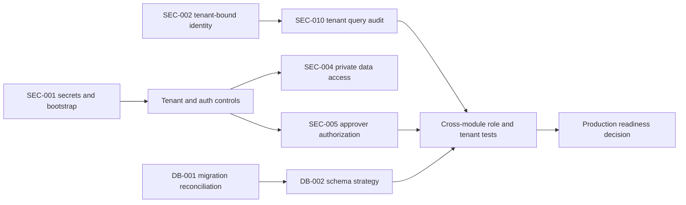

# Prioritized Remediation Roadmap

This is a proposal only. No fixes are implemented. Work is grouped by dependencies so that data protection and schema foundations precede business feature expansion. Effort is a rough engineering estimate in person-days and excludes product/legal decisions.

## Batch 0 — Contain P0 security risks (approval required before implementation)

| Issue | Priority / module | Root cause and implementation | FE / BE / DB changes | Dependencies / effort | Regression tests and acceptance |
|---|---|---|---|---|---|
| SEC-001 | P0 Config/auth | Rotate exposed/deployed values; move secrets to managed injection; disable demo/bootstrap accounts in production. | FE remove demo credentials; BE profile-gate safe bootstrap; DB/account rotation if deployed. | Ops access and inventory; 1–3 days plus rotation window. | Secret scan; fresh prod-profile startup; prove no seeded demo identity; all old secrets revoked. |
| SEC-002 | P0 Tenant/auth | Derive tenant from authenticated membership and validate membership before issuing token. | FE remove any misleading tenant selection; BE filter/JWT/auth binding; DB membership constraints as needed. | Product tenant model confirmation; 3–5 days. | Two-tenant login/token/API tests; tenant-A-only user cannot acquire tenant B. |
| SEC-003, SEC-011 | P0/P1 Auth/MFA | Replace broad public matcher with exact unauthenticated allowlist and apply owner/step-up/throttle controls to MFA/history/recovery. | FE MFA flows; BE route security and rate limits; DB attempt/lock records if required. | Auth UX/product policy; 3–6 days. | Anonymous/cross-user/throttle/recovery test matrix; only intended public routes work. |
| SEC-004 | P0 Employee/documents | Add tenant/object ownership checks and private file delivery; validate file signatures/content. | FE handle authorization errors/private download; BE authorization/storage changes; DB metadata migration may be needed. | Storage/retention decision; 5–10 days. | Anonymous, cross-user, cross-tenant, traversal and MIME tests; no public private file URL. |
| SEC-005 | P0 Workflow | Enforce current step assignee/role/delegation + tenant and atomic allowed transitions; scope inbox per actor. | FE task state and errors; BE service/repository guards; DB optimistic lock/audit migration likely. | Approval model confirmation; 4–8 days. | Unauthorized/stale/concurrent decision tests; only assigned actor can decide once. |

**Exit gate:** independent review of negative authorization tests and tenant boundary. No broad rollout until all P0 acceptance criteria pass.

## Batch 1 — Database and cross-cutting correctness

| Issue | Priority | Implementation | FE / BE / DB | Dependencies / effort | Acceptance |
|---|---|---|---|---|---|
| DB-001 | P1 | Reconcile Flyway history to PostgreSQL; test clean install and supported upgrade paths. | BE startup; DB migration baseline/versioned migrations. | Confirm supported DB/version and existing deployed schema; 3–8 days. | Disposable PostgreSQL migrates cleanly; constraints/indexes reviewed; data-preserving upgrade proven. |
| DB-002 | P1 | Make production schema strategy explicit: Flyway migrations and Hibernate validate, with dev profile separated. | Config/CI/DB pipeline. | DB-001; 1–2 days. | Production startup makes no schema changes; CI verifies migration. |
| SEC-010 | P1 | Audit tenant-owned reads/writes and relationship IDs; centralize tenant filter or exhaustively scope repository queries. | BE repositories/services; possible DB RLS/indexes. | SEC-002; 8–20 days, broad cross-module. | Cross-tenant negative tests for every entity family, including reports/files/jobs. |
| SEC-008 | P1 | Wire logout-all service and session revocation. | FE session reset; BE controller/service; refresh token persistence. | Auth redesign; 1–2 days. | Every previous refresh token fails after logout-all. |
| SEC-009 | P1 | Define request state transition graph and actor rules. | FE valid actions; BE state machine; DB constraints/audit if needed. | Product approval matrix; 2–4 days. | Invalid, stale and foreign-tenant transitions rejected transactionally. |

## Batch 2 — Web/API hardening and test harness

| Issue | Priority | Implementation | FE / BE / DB | Dependencies / effort | Acceptance |
|---|---|---|---|---|---|
| SEC-006 | P1 | Configure explicit HTTP/WebSocket origins and authorize STOMP connect/subscriptions. | FE origin/env config; BE CORS/socket security. | Known deployment domains; 2–4 days. | Positive/negative origin and subscription authorization tests. |
| SEC-007 | P1 | Move refresh credential to HttpOnly Secure SameSite cookie flow with CSRF/origin protections. | FE API client/auth slice; BE cookie/refresh endpoint. | SEC-003 and deployment TLS; 3–6 days. | JS cannot read refresh token; cookie and rotation/replay tests pass. |
| SEC-012 | P2 | Use trusted proxy address, bounded expiry and distributed limiter; apply policy to sensitive routes. | BE infrastructure; Redis config. | Redis availability/limits; 2–4 days. | Spoofed XFF ineffective; state bounded; throttle tests pass. |
| UI-001 | P2 | Align semantic selectors and Playwright base URL/protocol; add login error/success assertions. | FE labels/test config only. | Stable test environment; 1–2 days. | Deterministic login tests pass in CI. |
| PERF-002 | P2 | Page/assignee-scope workflow queries and replace per-row reads with projection/fetch strategy. | UI paging; BE query; DB indexes as explain indicates. | SEC-005 design; 2–4 days. | Correct scope, bounded page and query count under representative data. |
| PERF-001 | P2 | Analyze bundle, lazy-load route chunks and set a documented budget. | FE routes/build config. | Bundle analyzer; 2–4 days. | Agreed compressed bundle budget and route smoke tests pass. |
| PERF-002 + page limits | P2 | Apply shared page bounds across endpoints. | FE pagination; BE validation; DB indexes after profiling. | API contract; 2–5 days. | Boundaries and oversized-input behavior consistent across pageable APIs. |

## Batch 3 — Module-specific verification and product completion

1. Add an automated module/role journey matrix for attendance, policy assignment, leave, requests, workflow, payroll, documents, offboarding, shift, asset, helpdesk and reports.
2. Validate payroll/tax, leave accrual, attendance policy, settlement, privacy and retention with responsible business owners; capture approved examples as golden tests.
3. Verify SMTP/Redis/WebSocket/LiveKit-compatible/file-storage failure handling, idempotency and monitoring.
4. Decide required SSO, native mobile, biometric provider, object storage and external payroll integrations; scope as product work, not bug fixes unless required contractually.
5. Complete backup/restore, alerting, incident, access-review, support and deployment runbooks.

## Sequencing dependencies

Estimated effort is directional; the cross-cutting tenant audit and legacy schema migration require codebase/deployment discovery before committing a schedule. Begin only after the user approves the fixing phase, as directed by the mission.
