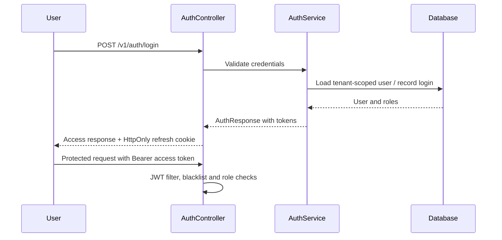

# Authentication and Authorization

## Authentication flow

`SecurityConfig` configures a stateless `SecurityFilterChain`. `AuthController` delegates to `AuthService`; `JwtAuthenticationFilter` reads `Authorization: Bearer …`, extracts username/tenant, checks blacklist status, loads `UserDetails`, validates the token and establishes Spring Security authentication. Password encoding uses `BCryptPasswordEncoder(12)`.

The refresh endpoint accepts a body token or cookie and issues a replacement cookie/token response. Login sets `refreshToken` as HttpOnly, SameSite=Lax, path `/`, max age seven days; the code currently sets `secure(false)`, which requires production review. Frontend code also reads a refresh token from local storage in `App.tsx`; verify which token storage path is active and avoid assuming cookie-only handling.

## Account lifecycle controls

Auth DTOs and services support registration, email verification/resend, login history, forgot-password OTP/reset, password change and first-login password status. TOTP setup/enable/disable endpoints and `TotpService` exist. The exact enforcement of TOTP at login, recovery-code behavior, lockout thresholds, OTP expiry and resend throttling must be confirmed in `AuthService`/configuration; endpoint presence alone does not prove each control is activated.

## Tenant resolution

`TenantContextFilter` reads `X-Tenant-ID`, alternate casing, `tenantId` query parameter, then host subdomain and finally default tenant. It writes the resolved ID in the response header and clears thread-local context in `finally`. JWT processing may replace the context from a token tenant claim. Tenant context should match the authenticated user's tenant; confirm mismatch handling and all repository predicates.

## Roles and route protection

`Role.java` defines role constants. The source includes `ROLE_SUPER_ADMIN`, `ROLE_ADMIN`, `ROLE_HR`, `ROLE_MANAGER`, `ROLE_EMPLOYEE`, `ROLE_IT_ADMIN`, and `ROLE_IT_SUPPORT` usage. `SecurityConfig` explicitly permits `/v1/auth/**`, current tenant metadata, guest interview paths, Swagger, selected actuator paths and `/uploads/**`; admin, dashboard, employee and department paths receive route-level restrictions. Most other APIs require authentication, with additional controller method-level `@PreAuthorize` rules.

| Role | Examples of guarded capabilities (not exhaustive) |
|---|---|
| `ROLE_SUPER_ADMIN` | Tenant creation/listing, selected tenant/admin, recruitment and system operations |
| `ROLE_ADMIN` | Employee/department administration, payroll/tenant settings, policy and operational configuration |
| `ROLE_HR` | Employee, leave, attendance, payroll, recruitment, documents and policy workflows |
| `ROLE_MANAGER` | Selected leave, regularization, shift, workflow and team review paths |
| `ROLE_EMPLOYEE` | Authenticated self-service routes, workflow inbox and request flows |
| `ROLE_IT_ADMIN` | Selected admin/dashboard, assets, helpdesk and employee route access |
| `ROLE_IT_SUPPORT` | Helpdesk update path and IT-oriented support behavior |

This is not a complete permission matrix. A number of endpoints accept user/employee IDs from request paths or query parameters and do not show an explicit `@PreAuthorize` annotation in the controller; verify ownership checks in service code and database queries.

## Security controls and limitations

- `JwtAuthenticationFilter` checks a distributed blacklist service; Redis configuration and fallback behavior must be confirmed for production.
- `RateLimitConfig` and `CorsConfig` exist; actual per-route policy/origin values vary by active config and are not reproduced here.
- CSRF is disabled because the API is stateless; refresh cookie use still warrants review of cross-site request behavior.
- The logout-all route currently returns a success response without visible service invalidation in its controller.
- Public `/uploads/**` access is configured. Assess whether user documents or private files can be exposed through this route.
- API authorization does not, by itself, prove tenant isolation; review entity scope, services and repositories together.

