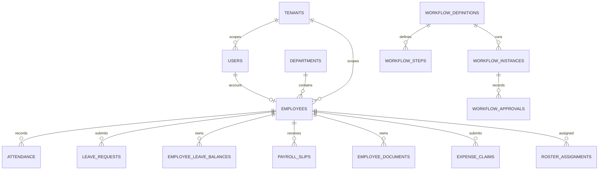

# Database Design

## Persistence approach

The backend uses Spring Data JPA entities with PostgreSQL-oriented application configuration. Flyway scripts are located under `backend/src/main/resources/db/migration` and currently range from V1 to V15. `docs/schema.sql` and root `hrms_db_seed.sql` are supplementary artifacts; they may not match the current migration chain. Always validate against the schema deployed for a specific environment.

## Entity/table inventory

Table names below come from entity `@Table` mappings. A listed entity does not prove its migration has been applied. Core tables without an explicit migration `CREATE TABLE` may be supplied by `docs/schema.sql` or earlier baseline history.

| Area | Tables / entities |
|---|---|
| Identity and tenancy | `users`, `tenants`, `tenant_subscriptions`, `tenant_settings`, `tenant_module_manifests`, `roles`, `permissions`, `role_permissions`, `user_roles`, `refresh_tokens`, `login_history` |
| Organization | `employees`, `departments`, `system_settings`, `audit_logs` |
| Attendance | `attendance`, `attendance_regularizations`, `biometric_devices`, `office_locations`, `attendance_policies`, `policy_assignments` |
| Leave and requests | `leave_requests`, `leave_policies`, `employee_leave_balances`, `employee_requests` |
| Workflow | `workflow_definitions`, `workflow_steps`, `workflow_instances`, `workflow_approvals`, `approval_delegations` |
| Payroll and tax | `payroll_slips`, `tax_declarations` |
| Recruiting | `job_postings`, `candidates`, `interview_sessions`, `interview_panelists`, `interview_scorecards` |
| Performance | `performance_reviews`, `appraisal_cycles`, `employee_goals` |
| Documents | `employee_documents`, `policy_acknowledgements` |
| Assets and expenses | `assets`, `asset_allocations`, `expense_claims` |
| Operations/communications | `notifications`, `support_tickets`, `ticket_comments`, `company_announcements`, `announcement_acknowledgments`, `shifts`, `roster_assignments`, `shift_swap_requests` |
| Offboarding/intelligence | `employee_separations`, `separation_clearances`, `full_and_final_settlements`, `hr_policy_articles`, `flight_risk_evaluations` |

Additional entity classes such as `Permission`/`TenantRole` should be cross-checked against pluralized join-table mappings and `docs/schema.sql`; naming is not inferred where no explicit mapping exists.

## Relationship model (logical)

The diagram is conceptual. Confirm exact foreign-key constraints, nullable relationships and cascade behavior in entity annotations and SQL before applying data changes.

## Tenant and audit model

`BaseTenantEntity` supplies tenant scope to tenant-aware entities; `BaseEntity` supplies common identity/audit fields where inherited. Migration V2 adds `tenant_id` to core tables and tenant-oriented indexes. V3–V15 add module tables/indexes. `TenantContextFilter` resolves a tenant per HTTP request. Tenant-aware repository methods are used in many modules, but object-level and query-level isolation should be reviewed per service.

## Migration map

| Version | Scope indicated by filename/content |
|---|---|
| V1 | Payroll column/index repair; SQL syntax is MySQL-like and conflicts with PostgreSQL target |
| V2 | SaaS tenancy/RBAC tables and tenant columns/indexes |
| V3 | Locations, attendance regularizations, leave policies/balances, requests, workflow, documents |
| V4 | Appraisal cycles/goals, scorecards, assets/allocations, tax declarations |
| V5 | First-login password flag |
| V6 | Attendance punch metadata and biometric devices |
| V7 | Offboarding, clearance and settlement |
| V8 | Helpdesk and communication |
| V9 | Shift and roster management |
| V10 | Workforce intelligence and HR policy content |
| V11 | Expense claims and payroll reimbursement column |
| V12 | Payroll draft/review adjustments/status/index |
| V13 | Interview sessions, guest access and scorecard updates |
| V14 | Multi-participant interview panelists |
| V15 | Tenant module manifests, attendance policies/assignments, approval delegations |

## Database concerns

- Run a migration compatibility review before applying the full chain to PostgreSQL; specifically inspect V1 and version ordering/baseline state.
- Reconcile JPA `ddl-auto`, Flyway state, `docs/schema.sql`, `hrms_db_seed.sql`, and environment schema. Avoid treating seed SQL as migration evidence.
- Document retention, PII classification, backup/restore, encryption, indexes and tenant deletion policies with operations and data owners.

