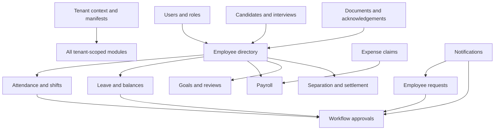

# Module Wise Documentation

Status labels describe evidence in source: **Implemented surface** means controller/service/UI or persistence code exists; it does not assert complete production behavior. **Partial / verify** identifies gaps or unverified paths.

| Module | Backend implementation | UI/API surface | Dependencies and status |
|---|---|---|---|
| Authentication | `modules/auth/AuthController`, `AuthService`, `TotpService`; shared JWT/security | Login, register, reset, verify and first-login pages | Implemented surface; logout-all behavior incomplete; see security doc |
| Employee & profile | `EmployeeController`, `EmployeeService`, `Employee`, `EmployeeRequest/Response` | Directory, form, details, profile | Implemented; ownership/role enforcement requires endpoint-level review |
| Departments | `DepartmentController`, `DepartmentService`, `Department` | Department page | Implemented CRUD surface |
| Attendance & policy | `AttendanceController`, `AttendanceService`, `GeofenceValidator`, policy resolver, regularization/device/location entities | Attendance page and Policy Config | Implemented surface; external biometric integration is ingestion, not vendor connector |
| Leave | `LeaveController`, `LeavePolicyController`, `LeaveService`, accrual scheduler | Leave page | Implemented surface; policy rules and scheduled execution need operational validation |
| Requests & workflows | `EmployeeRequestController`, `WorkflowController`, `WorkflowEngineService`, workflow entities | Requests and approvals pages | Implemented surface; approver filtering/notifications and SLA enforcement require verification |
| Payroll | `PayrollController`, `PayrollService`, `PayrollSlip` | Payroll page; PDF utility | Implemented processing/export surface; statutory formulas require business validation |
| Recruitment & interviews | Recruitment/Interview controllers and services, job/candidate/session/panelist/scorecard entities | Recruitment, guest lobby, interview room | Implemented surface; external media provider configuration and end-to-end signaling require verification |
| Performance | `PerformanceController`, `PerformanceService`, goals/cycles/reviews | Performance page | Implemented surface |
| Expense | `ExpenseController`, `ExpenseServiceImpl`, `ExpenseClaim` | Expense claims | Implemented submit/review surface; payroll bridge should be verified in transactional flow |
| Documents & policy acknowledgement | `DocumentController`, `DocumentService`, expiry scheduler | Document Vault, document APIs | Implemented upload/download/verification/acknowledge surface; storage encryption not established |
| Offboarding | `OffboardingController`, `OffboardingService`, separation/clearance/settlement entities | Offboarding page | Implemented workflow surface; legal formulas and completion checks need validation |
| Shift & roster | `ShiftRosterController`, `ShiftRosterService`, shift/assignment/swap entities | Shift roster page | Implemented surface |
| Assets | `AssetController`, `AssetService`, asset/allocation entities | Asset page | Implemented allocation/return surface |
| Helpdesk | `HelpdeskController`, `HelpdeskService`, ticket/comment entities | Helpdesk page | Implemented ticket/comment/stats surface |
| Communication | `CommunicationController`, `CommunicationService`, announcement entities | Announcements page | Implemented announcement/acknowledgement surface |
| Notifications | `NotificationController`, `NotificationService`, shared notification entity | Notifications page | REST and WebSocket support exist; delivery semantics should be verified |
| Workforce intelligence | `WorkforceIntelligenceController`, service implementation, risk/policy entities | Workforce Intelligence page | Local scoring/assistant functionality exists; external generative AI integration unverified |
| Reports & dashboard | `ReportController`, `DashboardController`, services | Reports and Dashboard pages | Implemented query surface; metric definitions/export scope require business confirmation |
| Tenant & admin | tenant/admin/module controllers and services | Admin and policies pages | Implemented surface; ensure all privileged operations enforce tenant scope |

## Cross-module dependencies

## Present but incomplete or not demonstrated

The current UI route list does not expose every API capability as a dedicated screen. The database migration directory does not visibly define every table represented by entities/seed data (notably core tables may be created in earlier/base SQL, and `tax_declarations` appears in V4). Confirm `docs/schema.sql`, seed SQL, and the deployed database as one source of truth. No separate time tracking, benefits enrollment, training/LMS, or expense attachment-specific receipt pipeline should be inferred unless the corresponding source path is confirmed.

