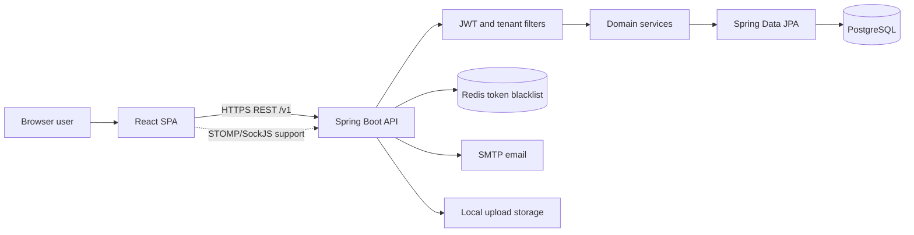

# Project Overview

## Purpose

HRMS Platform is a browser-based, multi-tenant human resources application. It combines a React single-page application with a Spring Boot REST service and PostgreSQL persistence. Implemented areas span employee records, attendance, leave, payroll, recruiting, approvals, documents, expenses, performance, shift rosters, support tickets and tenant administration.

This description reflects the repository implementation, not a claim of regulatory, payroll-provider, or enterprise readiness. See [module status](MODULE_WISE_DOCUMENTATION.md) and [review findings](DOCUMENTATION_INDEX.md#known-review-items).

## At a glance

| Concern | Implementation |
|---|---|
| Backend | Java 21 target, Spring Boot 3.2.3, Spring MVC, Spring Security, Spring Data JPA |
| Frontend | React 18, TypeScript/JavaScript, Vite, React Router, Redux Toolkit, Axios, Tailwind CSS |
| Persistence | PostgreSQL-oriented configuration, JPA entities, Flyway migrations V1–V15 |
| Authentication | Bearer JWT access tokens, refresh tokens, BCrypt, optional TOTP endpoints |
| Tenancy | Request tenant context filter; tenant-aware entities/repositories and tenant administration |
| Operations | Docker Compose for PostgreSQL, Redis, backend, frontend, Prometheus and Grafana |
| API prefix | `/api/v1` under the default `server.servlet.context-path=/api`; controller mappings themselves begin `/v1` |

## Implemented business areas

Core functionality is organized around employee and department records, attendance and attendance policies, leave and balances, employee requests and approval workflows, payroll, recruitment and interview sessions, performance, assets, expenses, documents and policy acknowledgements, offboarding, helpdesk, announcements, notifications, shifts, reporting, workforce intelligence, tenant branding/modules, and administrative audit/settings. Evidence and caveats are summarized in [Module Wise Documentation](MODULE_WISE_DOCUMENTATION.md).

## Architecture summary

The UI calls REST APIs through shared Axios clients and module-level API/service wrappers. Spring controllers validate and route requests to services; services coordinate repositories and domain rules; JPA entities persist to tenant-scoped tables. Flyway provides schema evolution. JWT and tenant filters run in the request chain. Email uses Spring Mail/Thymeleaf; Redis is used for distributed token blacklisting where configured; live interview functionality includes signaling/token components and a frontend LiveKit client. See [System Architecture](SYSTEM_ARCHITECTURE.md).

## Boundaries and open questions

The repository demonstrates a broad feature surface, but production topology, actual tenant isolation under all service queries, external identity integration, payroll statutory correctness, backup/restore procedures, and SLA behavior require operational confirmation. AI/assistant endpoints are present, but no external model provider integration is established by the source reviewed; the service implementation should be reviewed before describing responses as generative AI.

