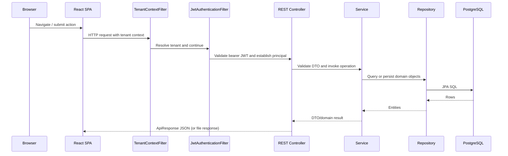

# System Architecture

## Architectural style

The system is a modular monolithic web application: a React SPA is deployed separately from a Spring Boot application. Backend code is organized by business module with controller/service/repository/entity/DTO layers. No independently deployable domain microservices were found.

## Runtime components

| Component | Responsibility | Evidence |
|---|---|---|
| React SPA | Routes, screens, state and API calls | `frontend/src/App.tsx`, `modules/`, `api/`, `store/` |
| REST API | HTTP endpoints and request validation | `backend/src/main/java/com/hrms/modules/*/controller` |
| Application services | Business orchestration and rules | module `service` packages |
| Persistence | ORM and repository access | JPA entities and Spring Data repositories |
| PostgreSQL | Relational data store | profiles, Flyway SQL, Compose |
| Redis | Token blacklist implementation | `DistributedTokenBlacklistService`, Compose |
| SMTP | Application email | `EmailServiceImpl`, Thymeleaf templates |
| Local storage | Profile/document uploads | `LocalStorageService`, `StorageService` port |
| Metrics | Health and Prometheus metrics | Actuator, Micrometer, `infra/monitoring` |
| Interview media | Session tokens/signaling; browser client | `LiveKitTokenService`, `InterviewSignalingService`, LiveKit frontend package |

## Request flow

## Backend layers

- `com.hrms.config`: security, CORS, WebSocket, async, rate limiting, request ID and data initialization.
- `com.hrms.modules`: domain modules; a module may not use every layer consistently.
- `com.hrms.entity` and `com.hrms.repository`: shared/core domain model and repositories.
- `com.hrms.dto`: core request and response transport objects.
- `com.hrms.security` and `infrastructure`: JWT, tenant context, Redis blacklist and storage implementation.
- `com.hrms.exception`: global error mapping and domain exception types.
- `com.hrms.common`: audit and mail support.

## Cross-cutting behavior and dependencies

The tenant filter establishes request scope; JWT claims may also set tenant context. Modules depend on shared employee/user/department records. Leave, attendance regularization and employee requests can use `WorkflowEngineService`; notifications and audit are shared services. Payroll references employee/attendance/expense data. Offboarding references employee records and settlement data. Recruitment conversion creates employee/user-related records (verify exact transactional semantics in `RecruitmentService`).

## Integration boundaries

Confirmed repository integrations are SMTP email, Redis, local filesystem upload storage, Prometheus scraping, and interview signaling/media token code. Docker Compose provisions PostgreSQL and Redis. No confirmed live bank, biometric-vendor, external identity, or AI-provider client is established from the reviewed integration code. Biometric input is represented by REST/CSV ingestion endpoints and device metadata.

## Architecture risks / verification

- Deployment profile and actual DB schema must be reconciled with V1–V15 migrations.
- The JWT and tenant filters' ordering and tenant claim/header precedence require security testing in the deployed configuration.
- `LocalStorageService` implies node-local files unless the deployment mounts shared persistent storage.
- WebSocket configuration is present; verify frontend subscriptions and authorization before relying on push delivery.
- A large shared application and domain service surface means regression and tenant-isolation testing are important; this document does not certify them.

