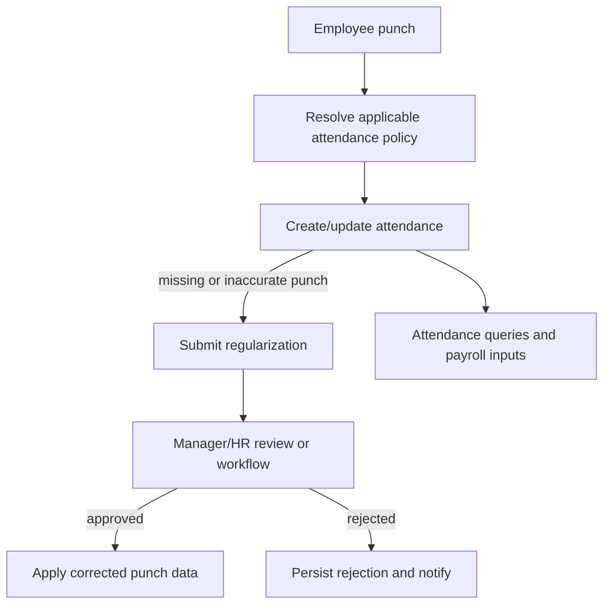

# User Workflows

Flows below reflect controller/service behavior and UI route surfaces. Exact validation, statuses and notification behavior can differ by module.

## Sign in and password recovery

1. User enters credentials on `/login`; frontend calls `authAPI`.
2. `AuthService.login` validates credentials and returns `AuthResponse`; controller sets refresh cookie.
3. Protected route access uses the access token. On expiry, the client can call refresh.
4. Users can verify email, request a reset OTP and submit reset credentials via the corresponding auth pages.
5. Users flagged `mustChangePassword` are routed to `/first-login-change-password`.

## Employee self-service and HR administration

1. HR/Admin creates an employee via `POST /v1/employees` and `EmployeeService` persists associated records.
2. User can view profile and upload a photo/document through employee APIs.
3. HR updates employee fields; deletion follows service soft-delete behavior (confirm retention rules).
4. Department assignment ties employee records to organizational grouping.

## Attendance and regularization

The service exposes web/auto punch, break tracking, biometric JSON/CSV ingestion, geofence validation, policy resolution and regularization. Approval can be routed through workflow support, but exact workflow activation is dependent on configured workflow definitions.

## Leave request and approval

1. Employee submits a leave application with employee ID and request details.
2. Service validates request and creates a pending leave record.
3. A manager/HR reviewer or workflow decision approves/rejects.
4. On workflow completion, `WorkflowEngineService` changes leave status and, for approval, updates a matching employee leave balance when found.
5. Notification is sent to employee. Cancellation and policy/balance endpoints support follow-up.

## General employee request and approval

1. Employee creates an `EmployeeRequest` for a supported request type.
2. Review or workflow processing records decisions and comments.
3. On completion, request status is updated and notification is sent. Delegation records can be created for out-of-office coverage.

The code does not establish the README-claimed universal request types, atomic conflict checks or SLA deadlines as guaranteed behavior; confirm `EmployeeRequestService`, workflow configuration and database constraints.

## Payroll processing

1. Authorized payroll user initiates a single or batch process.
2. `PayrollService` gathers employee and attendance data and calculates payroll records.
3. HR can adjust/approve records; approved payroll can be marked paid.
4. Payroll register, summaries, employee payslips and bank batch exports are exposed.
5. Frontend includes payslip PDF generation utility.

Formula correctness, tax configuration, expense inclusion and bank file acceptance require payroll-owner confirmation.

## Recruitment and interview

1. Recruiter creates a job and candidate record.
2. Candidate stage and scorecards are updated through recruiting APIs.
3. Interview session is scheduled; a guest token can be used by a candidate to join a lobby/room.
4. Interviewers can join, exchange signaling messages and submit scorecards; panelists may be assigned.
5. Candidate conversion endpoint supports converting a candidate into employee onboarding. Verify atomicity, generated credentials, leave seeding and email behavior in service implementation.

## Expense, helpdesk and communications

- Expense: employee submits a claim; manager review precedes finance review endpoints. The implemented enum/status transitions should be confirmed in `ExpenseServiceImpl`.
- Helpdesk: user creates ticket, comments may be added, support roles update ticket, and stats are queried.
- Announcements: authorized staff creates/deletes announcements; active/all lists and acknowledgement endpoint support employee response.

## Offboarding

1. Employee submits separation request.
2. Authorized reviewer reviews it and clearance records are updated.
3. Settlement is calculated/saved and queried by separation.
4. Final employee status changes and generated documents depend on service behavior; verify required clearance completeness before relying on termination finalization.

